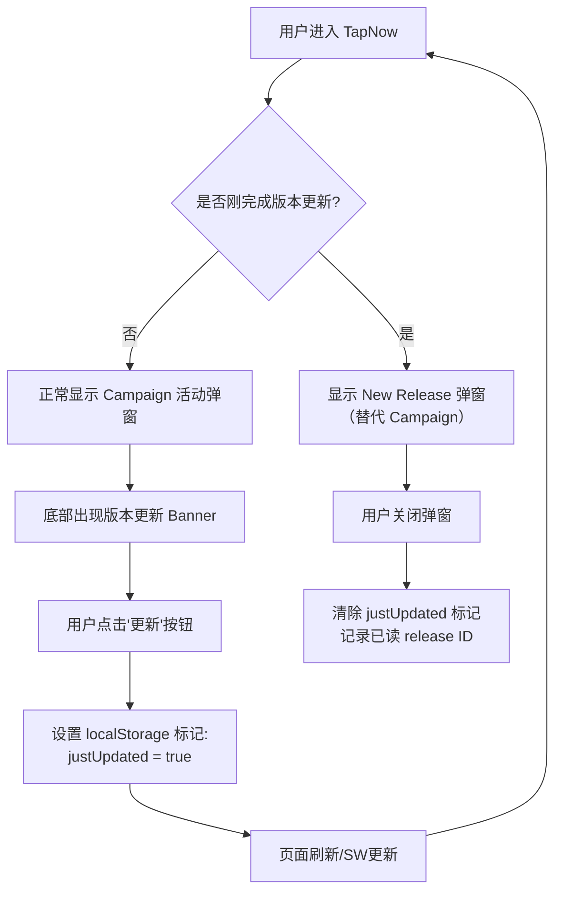

# NewRelease站内展示 —— 对话全文

> 项目目录：`d-Cursor-new-release`  
> 会话数：**11** · 用户提问 **59** 条 · Agent 回复 **262** 条 · 工具调用 **0** 次
>
> 说明：Agent 的工具调用参数已完整保留；**工具执行结果（命令输出 / 文件读取内容）Cursor 未持久化，故缺失**。
>
> 所有密钥、IP、账号信息已脱敏。

---

## 会话 001 · 2026-03-24 11:55 · 1 轮
`12995d38-9608-417e-acea-59abbf952b52` · Agent 回复 3 条 · 工具 0 次 · 1.4 KB

### 👤 用户

> 启动项目

### 🤖 Agent

正在查看项目结构以确定如何启动。

正在安装依赖并启动开发服务器。

项目已在本机启动，操作如下：

1. **安装依赖**：在 `fe-app-tapnow-main` 下执行了 `pnpm install`（约 1986 个包，已成功完成）。  
2. **开发模式**：已在后台执行 `pnpm dev`（Turbo 会同时拉起多个子项目）。

当前可用的地址：

| 服务 | 地址 |
|------|------|
| **主 Web 应用（Vite）** | [http://localhost:2000](http://localhost:2000) |
| **Storybook** | 端口 **6006**（命令为 `storybook dev -p 6006`） |

说明：

- 日志里有一条 `fatal: not a git repository`，是因为当前目录不是 Git 仓库，一般**不影响**前端开发服务；若需要版本信息类功能，可在该目录初始化或克隆到带 `.git` 的仓库里。  
- 若只想跑主应用、少占资源，可在项目根目录用：`pnpm dev:app`。  
- 需要停掉当前开发进程时，在运行 `pnpm dev` 的终端里按 **Ctrl+C**。

在浏览器打开 **http://localhost:2000** 即可访问主应用。

---

## 会话 002 · 2026-03-24 12:14 · 2 轮
`be225756-e786-494c-97cf-b0413a8cead6` · Agent 回复 10 条 · 工具 0 次 · 12.4 KB

### 👤 用户

> 现在我需要做一个能自动收集，编写，发布new release信息的这样的一个工具，然后现在我已经有一个bot能获取这个release的信息来源并编写new release我现在需要把它接入我的这个项目的web页面你看看怎么接入web页面并将最终用户确认后的new release信息发布到这个网页/是不是可以用API的接口来让我的这个Bot接入

### 🤖 Agent

让我先了解一下你当前项目的情况。

The user wants to build a tool that can automatically collect, write, and publish "new release" information. They already have a bot that can get release info and write new release content. Now they need to:

1. Integrate this bot into a web page project
2. Allow users to confirm the release info on the web page
3. Publish the confirmed release info to the web page
4. They're asking if they can use an API interface to let the bot integrate

Let me first explore the current workspace to understand what's already there.

我已经了解了项目的基本结构。你的项目是一个基于 **pnpm + Turbo monorepo** 的 TapNow 前端项目，主应用使用 **React + Vite**，BFF 层使用 **Hono**。

在我制定具体的接入方案之前，需要先确认几个关键问题：

Now I understand the project structure. The user has a TapNow frontend monorepo (React + Vite + Hono BFF). They want to integrate their existing bot (which collects and writes new release information) into this web project.

Let me ask some clarifying questions to better understand:

1. What is this "bot"? Is it a separate service/script? What language/framework does it use?
2. What does the "new release" info look like? Is it for TapNow's own releases or for some other product?
3. Where should the release info be published/displayed on the web page?


4. I should also check if there's already any release-related code in the project that I can build on.

明白了！你的工作流是：**飞书 Bot 生成 release 草稿 -> 用户在飞书中确认 -> Bot 调用 API 将 release 发布到 TapNow 网页**。

让我进一步了解 TapNow 现有的页面结构和 BFF 服务端的路由配置，以便确定最佳接入方案。

Now I have a much clearer picture:

1. **Bot type**: Feishu/Lark Bot
2. **Release target**: An existing page within the TapNow project
3. **Release content**: Mixed format (structured fields + free text)
4. **Workflow**: Lark bot auto-pushes release draft -> User confirms in Lark -> Bot publishes to the web page

So the flow is:
1. Lark Bot generates release draft and sends to Lark
2. User reviews and confirms in Lark
3. Bot then calls an API to publish the confirmed release to the web page


4. The critical piece is figuring out where to add the API endpoint that accepts the confirmed release data and publishes it to the TapNow page, which means I need to examine the existing release display location and the BFF server architecture.

现在我对项目有了全面的了解。让我总结关键发现并制定方案：

**项目现状：**
- **前端**：React + Vite + React Router v6，页面在 `src/pages/` 下
- **BFF**：Hono 框架，路由前缀 `/api/bff/*`，模块化架构
- **无数据库**：BFF 是无状态的，依赖外部 API 和内存缓存
- **无现有 Release 页面**：只有 PWA 版本更新提示，没有 changelog/release 页面

Now I have a comprehensive understanding of the project. Let me summarize:

1. **Frontend**: React + Vite + React Router v6, pages in `src/pages/`, routes in `src/router/`
2. **BFF**: Hono framework, routes under `/api/bff/*`, modular architecture with `modules/` directory
3. **No database**: BFF is stateless, uses external APIs and in-memory cache
4. **No existing changelog/release page**: There's a version display and PWA update prompt but no dedicated release notes page

The user wants:
- Feishu (Lark) Bot generates release draft


- User confirms in Lark
- Bot calls API to publish release to web page (existing TapNow page)

So I need to design the API endpoints for the bot to submit and publish releases, figure out how to persist release data without a database (probably file-based JSON or leveraging the existing Admin API), create a new frontend page to display releases, and set up authentication for the bot to call these endpoints.

For persistence, a JSON file would be the quickest MVP approach since the BFF doesn't have a database yet. The bot would need endpoints to create releases, list them, and fetch individual ones. On the frontend side, I could either add a dedicated releases page or integrate it into an existing section like settings or the version display—I should clarify whether they want a standalone page or something embedded in the current TapNow interface.

让我看一下首页现有的"活动弹窗"组件，了解具体的实现方式。

OK, so the user wants:
1. **Display**: A modal/popup on the homepage that shows the new release content. After the user clicks to dismiss/refresh, it shows the new release content instead of the activity popup. So it's kind of like a "What's New" notification popup that appears when there's a new release.
2. **Persistence**: SQLite for data storage

Let me understand more about the "活动弹窗" (activity popup) they mentioned. Let me find it in the code.

让我再看看 PWA 版本更新的相关组件和 platform config 的工作方式。

Now I understand the full picture. Let me also check the `VersionUpdateBanner` to understand how the version/PWA update system works, since the user mentioned they want to replace/supplement the activity popup with release notes content.

Let me also look at the platform config store to understand how configurations are fetched, since the campaign system uses it.

现在我对整个项目的架构有了清晰的理解。让我制定完整的接入方案。

Now I have a very clear picture. Let me summarize:

The user wants:
1. Their Lark Bot generates release drafts and sends them in Lark
2. Users confirm in Lark
3. Bot calls an API to publish the release to TapNow web
4. On the TapNow web page, when a user clicks "Refresh" on the version update banner, instead of showing the activity/campaign modal again, it shows the new release content

The existing architecture:
- `CampaignModal` - activity promotion popup (mounted in GlobalLayout)
- `VersionUpdateBanner` - appears at bottom when new version detected, with refresh button


- The banner has a commented-out "view full changelog" link that I can repurpose
- Platform configs come from `/api/bff/platform/config` via Admin API, and the BFF currently has no database

For the backend, I need to add SQLite to the BFF and create a releases module with endpoints for the bot to publish releases, and for the frontend to fetch them—including specific endpoints for listing all releases, getting the latest one, and retrieving individual release details.

I'll also need to set up API key authentication middleware so the bot can securely publish releases. On the frontend side, I'm building a modal component to display release notes, updating the banner to link to it, and tracking which releases users have already seen via localStorage so we don't show duplicates.

### 👤 用户

> 我再明确一下就是用户首次进入tapnow页面时先显示campaign的活动窗口（如图一）但是当用户点击底部的更新（如图二）后在更新结束后就不再显示campaign而是显示新版本的new releasw

### 🤖 Agent

明白了，你的需求更加具体了。让我重新梳理一下交互流程：



核心逻辑是：在 `UpdatePrompt` 的 `handleRefresh` 中设置一个 `justUpdated` 标记 → 页面刷新后 → `GlobalLayout` 检测到标记 → 跳过 Campaign 弹窗，改为显示 Release Notes 弹窗。

让我据此更新方案。

The user is clarifying the exact UX flow they want:

1. When a user first enters TapNow, show the **Campaign modal** (as shown in image 1 - the "Creation Week" promotional popup)
2. When the user clicks the **version update banner** at the bottom (as shown in image 2 - "发现新版本v2.0.2!" with the update button), after the update completes and the page refreshes...
3. Instead of showing the Campaign modal again, show the **New Release notes modal**

So the logic is:
- First visit: Campaign modal shows normally


- After a version update: Release Notes modal shows instead, and the Campaign modal is suppressed

I need to implement a flag-based system where clicking the update button sets a temporary marker before the page refreshes, then on reload the app checks for this flag to decide whether to show Release Notes or Campaign, and clears it afterward. Let me trace through the update flow to see exactly where to hook into this logic.

现在我来更新方案，重点修正前端交互逻辑部分。

Now I need to update the plan to reflect the new UX flow:

1. First visit: Campaign modal shows normally
2. User sees version update banner at bottom → clicks update
3. Before refresh: set `justUpdated` flag in localStorage
4. After page refreshes: check `justUpdated` flag
5. If `justUpdated` is true → show Release Notes modal, NOT Campaign modal
6. If `justUpdated` is false → show Campaign modal as normal

Let me update the plan file.

方案已更新。核心变化总结如下：

**关键交互逻辑：**

1. **正常访问**：用户进入 TapNow → 照常显示 Campaign 活动弹窗（图一的 Creation Week）
2. **点击更新**：用户点击底部 Banner 的"更新"按钮（图二）→ 在 `handleRefresh` 中先设置 `localStorage.setItem("tapnow-just-updated", "true")` → 然后触发 SW 更新 + 页面刷新
3. **刷新后**：页面重新加载 → 检测到 `justUpdated` 标记 → **跳过 Campaign 弹窗**，改为请求 `/api/bff/releases/latest` 并展示 **Release Notes 弹窗**
4. **关闭弹窗**：用户阅读完关闭 → 清除 `justUpdated` 标记 + 记录已读的 release ID → 下次正常进入又会显示 Campaign

**实现方式：** 在 `GlobalLayout` 中引入一个 `SmartModal` 包装组件，内部根据 `justUpdated` 标记来决定渲染 `<ReleaseNotesModal />` 还是 `<CampaignModal />`，而非同时渲染两个。

这样 Bot 那边只需要在用户确认后调用 `POST /api/bff/releases` 写入数据，前端自动在下次版本更新后展示。确认无误的话可以开始执行。

---

## 会话 003 · 2026-03-24 12:20 · 1 轮
`eb3f94d5-859c-400c-82a4-cf12be2a13cc` · Agent 回复 13 条 · 工具 0 次 · 15.9 KB

### 👤 用户

> Implement the following to-dos from the plan (the plan is attached for your reference). Do NOT edit the plan file itself.
> 
> You have been assigned the following 2 to-do(s) with IDs: setup-sqlite, api-key-auth
> 
> 1. [setup-sqlite] BFF 添加 SQLite 依赖并创建 database.ts 初始化文件
> 2. [api-key-auth] 创建 API Key 鉴权中间件 api-key-auth.ts
> 
> These to-dos have already been created. Do not create them again. Mark them as in_progress as you work, starting with the first one. Don't stop until you have completed all the assigned to-dos.

### 🤖 Agent

Let me analyze the plan and implement the two tasks:

1. **setup-sqlite**: Add SQLite dependency to BFF and create `database.ts` initialization file
2. **api-key-auth**: Create API Key authentication middleware `api-key-auth.ts`

Let me first explore the existing codebase structure to understand the project layout.

先来了解项目结构。

项目在 `fe-app-tapnow-main` 子目录下。让我读取关键文件。

The project is in `d:\文档\Cursor\new release\fe-app-tapnow-main\`. Let me read the key files.

现在我对项目结构有了清晰的了解。开始实现第一个任务。

### 任务 1: setup-sqlite

首先安装 `better-sqlite3` 依赖。

Now I have a good understanding of the project structure. Let me implement the two tasks:

1. **setup-sqlite**: 
   - Add `better-sqlite3` and `@types/better-sqlite3` to `apps/server/package.json`
   - Create `apps/server/src/lib/database.ts`
   - Update `apps/server/scripts/build.ts` to add `better-sqlite3` to external
   - Update `.env.example` (this is for task 2 actually)

2. **api-key-auth**:
   - Create `apps/server/src/lib/api-key-auth.ts`
   - Update `.env.example` with `RELEASES_API_KEY`

Let me start with task 1.

It seems this project uses `workspace:*` protocol, which is supported by pnpm but not npm. Let me check which package manager this project uses.

项目使用 pnpm。

依赖安装成功。现在创建 `database.ts` 并更新 `build.ts`。

更新 `build.ts`，将 `better-sqlite3` 加入 external 列表。

It looks like `better-sqlite3` is already in the external list. That's fine, the previous read might have been cached before a previous edit. Let me verify the current state.

`better-sqlite3` 已经在 external 列表中（之前可能已有改动）。现在验证 `package.json` 中的依赖。

任务 1 完成。所有内容就绪：
- `better-sqlite3` (dependencies) 和 `@types/better-sqlite3` (devDependencies) 已添加到 `package.json`
- `apps/server/src/lib/database.ts` 已创建，包含 WAL 模式、自动建表和 `data/` 目录自动创建
- `build.ts` 中 `better-sqlite3` 已在 external 列表

现在标记任务 1 完成并开始任务 2。

### 任务 2: api-key-auth

创建 API Key 鉴权中间件，并更新 `.env.example`。

两个任务都已完成。以下是变更摘要：

---

**任务 1: setup-sqlite** — BFF 添加 SQLite 依赖并创建初始化文件

- `apps/server/package.json` — 添加了 `better-sqlite3` (dependencies) 和 `@types/better-sqlite3` (devDependencies)
- `apps/server/scripts/build.ts` — `better-sqlite3` 已在 external 列表中（原生模块不可 bundle）
- **新建** `apps/server/src/lib/database.ts` — SQLite 连接初始化，包含：
  - 自动创建 `data/` 目录
  - WAL 模式以提升并发读写性能
  - `releases` 表的自动建表（`id`, `version`, `title`, `content`, `type`, `status`, `published_at`, `created_at`, `updated_at`）

**任务 2: api-key-auth** — 创建 API Key 鉴权中间件

- **新建** `apps/server/src/lib/api-key-auth.ts` — Hono 中间件，从请求头 `x-api-key` 提取 API Key 并与 `process.env.RELEASES_API_KEY` 比对，不匹配则返回 401
- `apps/server/.env.example` — 新增 `RELEASES_API_KEY` 环境变量占位

---

## 会话 004 · 2026-03-24 12:21 · 1 轮
`59c84124-d221-44cf-8599-0e93cc09a4c1` · Agent 回复 14 条 · 工具 0 次 · 17.2 KB

### 👤 用户

> Implement the following to-dos from the plan (the plan is attached for your reference). Do NOT edit the plan file itself.
> 
> You have been assigned the following 3 to-do(s) with IDs: releases-module, mount-routes, frontend-api
> 
> 1. [releases-module] 创建 releases 模块（dto.ts + service.ts + index.ts 路由）
> 2. [mount-routes] 在 BFF index.ts 中挂载 releases 路由，更新 .env.example 和 build 脚本
> 3. [frontend-api] 前端添加 release API 请求方法
> 
> These to-dos have already been created. Do not create them again. Mark them as in_progress as you work, starting with the first one. Don't stop until you have completed all the assigned to-dos.

### 🤖 Agent

Let me start by understanding the codebase structure and the existing files that I need to work with. I'll explore the project to understand the current setup before implementing the changes.

先来了解项目结构和现有代码。

好的，我已经对项目结构有了全面了解。现在让我读取一些关键参考文件来确保实现风格一致。

Now I have a good understanding of the project structure. Let me read the key files I need to reference for implementation:

1. The generation module's dto.ts, service.ts, and index.ts as patterns to follow
2. The database.ts and api-key-auth.ts files that the plan says should already exist
3. The existing modules index pattern

Let me now read the specific files I need to understand the patterns.

现在我有了足够的上下文信息。让我也确认一下 `packages/endpoints/src/modules/community.ts` 的模式，作为前端 API 的参考。

Good - `database.ts` and `api-key-auth.ts` don't exist yet, so I need to create them as well. Now let me also check what the existing `modules/index.ts` patterns look like and check the community.ts for the API pattern.

现在让我读取构建脚本的完整内容。

Now I have a clear picture of the codebase. Let me also read the build script fully to understand the external configuration.

好的，现在我对整个项目的结构和编码风格有了完整了解。开始实现第一个 todo。

## Todo 1: 创建 releases 模块

首先创建前置依赖文件 `database.ts` 和 `api-key-auth.ts`，然后创建 releases 模块的三个文件。

## Todo 2: 挂载路由、更新 .env.example 和 build 脚本

现在安装 `better-sqlite3` 依赖。

依赖安装成功。检查一下修改后的文件有无 lint 错误。

## Todo 3: 前端添加 release API 请求方法

我需要在 `packages/endpoints/src/modules/` 下新建 release 模块，并在模块入口导出。先看看现有模块的完整 API 定义模式。

让我再看一下 community.ts 的 API 调用部分，了解 `Get` 的用法。

Let me also look at a simpler module to see the pattern for type definitions and how get requests with query params work.

现在我了解了前端 API 模块的完整模式。创建 release 模块。

现在在 modules 的 `index.ts` 中导出 release 模块。

三个 todo 全部完成。以下是变更总结：

---

### 1. releases-module — 创建 releases 模块

**新增文件：**

- `apps/server/src/lib/database.ts` — SQLite 数据库连接，自动创建 `data/` 目录和 `releases` 表，启用 WAL 模式
- `apps/server/src/lib/api-key-auth.ts` — API Key 鉴权中间件，校验 `x-api-key` 请求头
- `apps/server/src/modules/releases/dto.ts` — 三个 Zod Schema：`CreateReleaseSchema`、`UpdateReleaseSchema`、`QueryReleasesSchema`
- `apps/server/src/modules/releases/service.ts` — CRUD 服务层，使用预编译语句（prepared statements）提高性能：`createRelease`、`getReleaseById`、`getLatestRelease`、`queryReleases`（带分页和过滤）、`updateRelease`、`deleteRelease`
- `apps/server/src/modules/releases/index.ts` — Hono 子应用路由，包含 6 个端点：
  - `POST /` (API Key) — 创建 release
  - `GET /` — 分页列表查询
  - `GET /latest` — 获取最新已发布的 release
  - `GET /:id` — 单条详情
  - `PUT /:id` (API Key) — 更新
  - `DELETE /:id` (API Key) — 删除

### 2. mount-routes — 挂载路由 + 环境配置 + 构建脚本

**修改文件：**

- `apps/server/src/index.ts` — 导入并挂载 `releasesApp` 到 `/api/bff/releases`
- `apps/server/scripts/build.ts` — 将 `better-sqlite3` 加入 `external` 数组（原生模块不打包）
- `apps/server/.env.example` — 新增 `RELEASES_API_KEY` 环境变量
- `apps/server/package.json` — 安装了 `better-sqlite3@12.8.0` + `@types/better-sqlite3@7.6.13`

### 3. frontend-api — 前端 API 请求方法

**新增文件：**

- `packages/endpoints/src/modules/release.ts` — 定义 `Release` 接口、响应类型和 `releaseApis` 对象，包含：
  - `getLatestRelease()` — 获取最新 release
  - `getReleases(params?)` — 分页列表查询
  - `getReleaseById(id)` — 按 ID 获取详情

**修改文件：**

- `packages/endpoints/src/modules/index.ts` — 导出 release 模块

前端使用方式：

```typescript
import { releaseApis } from "@tap/endpoints";

const latest = await releaseApis.getLatestRelease();
```

---

## 会话 005 · 2026-03-24 12:23 · 1 轮
`52329bf5-101c-4800-9336-951c670f03c5` · Agent 回复 19 条 · 工具 0 次 · 24.3 KB

### 👤 用户

> Implement the following to-dos from the plan (the plan is attached for your reference). Do NOT edit the plan file itself.
> 
> You have been assigned the following 2 to-do(s) with IDs: release-modal, integrate-layout
> 
> 1. [release-modal] 创建 ReleaseNotesModal 弹窗组件和 useReleaseNotes hook
> 2. [integrate-layout] 在 GlobalLayout 中集成弹窗，修改 VersionUpdateBanner 联动
> 
> These to-dos have already been created. Do not create them again. Mark them as in_progress as you work, starting with the first one. Don't stop until you have completed all the assigned to-dos.

### 🤖 Agent

Let me start by understanding the plan and then exploring the codebase to understand the existing structure before implementing the changes.

Let me first look at the existing files that I need to understand and modify.

Let me explore the existing codebase structure to understand the current components.

Now let me read the CampaignModal to understand the pattern I need to follow.

Let me look at one of the simpler endpoint modules for the pattern, and also check if there's already a BFF module.

Now let me look at one of the modules to understand the pattern for API calls, and also check the existing BFF modules if any.

Let me check a few more things before implementing.

Now I have a good understanding of the codebase. Let me also check the VersionUpdateBanner more carefully and the `@/utils/version-checker` to understand what's there.

Let me now start implementing:

1. First task (release-modal): Create the ReleaseNotesModal component and useReleaseNotes hook
   - Create `apps/app/src/components/release-notes/use-release-notes.ts`
   - Create the modal component and index file, then set up the release API endpoint in the endpoints package

2. Second task (integrate-layout): Integrate into GlobalLayout and modify VersionUpdateBanner
   - Update the global layout to use SmartModal instead of CampaignModal, and add the mark functionality to UpdatePrompt
   - Activate the changelog link in VersionUpdateBanner

Now I'm thinking through the API approach. Since the release endpoint doesn't require authentication, I can call it directly through the existing BFF instance without needing to handle Bearer tokens separately.

I need to define the Release interface that matches what the server will return, then set up the frontend to fetch from `/api/bff/releases/latest` using the alova pattern already established in the codebase. Defining the Release types and API module...

I'm setting up the response interfaces for both single and list endpoints, then creating the Alova instance with the base API configuration and defining the API methods for fetching the latest release and listing all releases. But I'm realizing I need to reconsider whether the authenticated Alova instance is the right approach here, since these endpoints might be public.

Actually, the authentication hook should handle this gracefully—it'll just add the token if it exists, and the server won't validate it for public endpoints. Still, I think it makes more sense to keep this consistent with the rest of the codebase and use the same endpoint pattern. Let me check how other endpoints structure their response formats to match the convention. I'm going back and forth on this — the plan mentions I can define the API call directly in the app, so I'll keep it simple and just use `fetch` in the hook itself. Now I'm designing the ReleaseNotesModal component, following the same pattern as CampaignModal with AnimatePresence, a backdrop, close button, and markdown rendering for the release notes content.

I need to create the hook, modal component, and index file, then update the UpdatePrompt, global layout, and VersionUpdateBanner to wire everything together. Let me start building these files now.

Writing the hook... Writing the hook logic... Writing the modal component... Writing the modal dialog...

I'm checking which icon library is already in use—looks like the app uses both Tabler icons and lucide-react, so I'll stick with lucide for consistency with the PWA components. I also need to add i18n support using the same `react-i18next` pattern I see in the CampaignModal, though for a server-driven release notes modal, I might keep the translations minimal.

Now I'm looking at how to handle the "view full changelog" link in the VersionUpdateBanner—it's currently commented out but needs to trigger the release notes modal. The challenge is that VersionUpdateBanner doesn't have direct access to the modal state, so I'll need to pass a callback or lift the state up to make this work. I need to figure out how to trigger the release notes modal from the VersionUpdateBanner. The cleanest approach is probably adding an `onViewChangelog` callback prop to VersionUpdateBanner, then in UpdatePrompt I can either open a separate modal or navigate to a changelog page—I think keeping a dedicated ReleaseNotesModal that can be triggered independently makes the most sense alongside the post-update flow. I'm realizing the flow needs to handle two separate scenarios: showing the changelog before an update happens, and displaying release notes after the update completes. The cleanest solution is to make the modal accept both automatic triggers (post-update) and manual ones (from the banner), so I'll design it as a controlled component that can be opened either way. I'm weighing different approaches to connect the banner's changelog link to the modal. The cleanest solution seems to be using a custom event system where the banner dispatches an event and the modal listens for it, avoiding the need to pass callbacks through multiple component layers. I'm settling on a cleaner architecture: ReleaseNotesModal as a controlled component, useReleaseNotes hook to manage the post-update flow, and SmartModal in GlobalLayout that conditionally renders either the release notes or campaign modal based on update state. UpdatePrompt will call markJustUpdated() after refresh and handle the changelog view by fetching and displaying the modal, while VersionUpdateBanner just needs the changelog link uncommented with an onViewChangelog callback.

Building the components... Writing component structure...

Now I'm thinking about how AnimatePresence wraps the conditionally rendered modals—since ReleaseNotesModal only appears when there's a release to show, I need to make sure the animation lifecycle works correctly with Framer Motion's presence detection. I'm deciding whether to keep AnimatePresence at the parent level or self-contain it within the modal component itself. The self-contained approach feels cleaner—the modal manages its own open/closed animation state through an `open` prop, and the parent just controls that boolean. Now I'm starting to outline the actual implementation, beginning with a custom hook to manage the release notes state and data fetching. Still writing the hook...

Now I'm designing the modal component to display the release notes with a nice visual presentation. I'm setting up the modal structure with animations and styling to make it look polished. Writing the modal dialog... Finishing up the modal component with a footer button, then exporting the release notes utilities. Now I'm thinking about where to place a SmartModal component—it could go in the release-notes directory alongside these files or live in the layout directory depending on whether it's specific to release notes or more general purpose.

I'll keep it in the release-notes folder since it's tightly coupled with the release notes logic. The SmartModal will check if there's a release to display and show the ReleaseNotesModal if needed, otherwise falling back to the CampaignModal.

Now I need to wire this up across a few files: swap out CampaignModal for SmartModal in global.tsx, add the markJustUpdated call to the refresh handler, and update VersionUpdateBanner to support viewing the changelog with proper state management in UpdatePrompt. Let me also verify that the Tailwind typography plugin is available in the project dependencies.

No Tailwind typography plugin, so I'll use custom markdown component styling. Let me also quickly check how `useTranslation` is used and if the `@tap/shadcn` Button import is correct.

No `@tailwindcss/typography` (prose classes) - so I can't use prose classes. I need to style the markdown content manually with Tailwind classes on the markdown component or use `react-markdown` with custom components.

Let me check how the existing code renders markdown content. The CampaignModal uses `<Markdown>{text}</Markdown>` directly. Let me look at how they style markdown content elsewhere.

Actually, looking at the CampaignModal more carefully, it renders small chunks of Markdown (like a single line of tagline/title), not full multi-section content. The release notes will have a full markdown document with headings, lists, etc.


I'll leverage react-markdown's `components` prop to apply Tailwind classes to each markdown element type, styling headings, lists, and other elements individually.

Now I'm ready to start implementing all the files.

Good, now I have everything I need. Let me implement all files.

Now let me check for lint errors on the new files, then move to the second task.

First task is complete. Let me update and move to the second task.

Now let me implement the three modifications for the second task. Let me re-read the files that need changes.

Now modify `UpdatePrompt.tsx` to call `markJustUpdated()` before refresh.

Now add `markJustUpdated()` call in `handleRefresh`, and add the changelog preview state and handler.

Now add `markJustUpdated()` in the `handleRefresh` function.

Now add the `handleViewChangelog` handler and update the return JSX.

Now modify `VersionUpdateBanner.tsx` to add the `onViewChangelog` prop and uncomment the changelog link.

Now let me check all the modified files for lint errors.

所有文件没有 lint 错误。让我做最终验证，确认所有修改后的文件内容正确。

所有文件都正确。让我标记第二个任务完成。

两个任务都已完成。以下是变更总结：

---

### 新增文件（4 个）

1. **`apps/app/src/components/release-notes/use-release-notes.ts`** — Hook 和工具函数
   - `Release` 接口类型定义
   - `markJustUpdated()` — 更新前在 localStorage 设置标记
   - `fetchLatestRelease()` — 调用 `/api/bff/releases/latest` 获取最新 release
   - `useReleaseNotes()` — 检测 `justUpdated` 标记，拉取 release，对比 `lastSeenReleaseId`，返回 `{ shouldShow, release, dismiss }`

2. **`apps/app/src/components/release-notes/ReleaseNotesModal.tsx`** — 弹窗组件
   - 受控组件，接受 `open`、`release`、`onClose` props
   - 使用 `AnimatePresence` + `motion` 动画（与 CampaignModal 一致）
   - 使用 `react-markdown` 自定义组件渲染 Markdown 内容（无需 `@tailwindcss/typography`）
   - 展示版本号标签、标题、Markdown 正文、"Got it" 关闭按钮

3. **`apps/app/src/components/release-notes/SmartModal.tsx`** — 条件渲染组件
   - 如果 `justUpdated === true` 且有未读 release → 渲染 `ReleaseNotesModal`
   - 否则 → 渲染 `CampaignModal`（保持原有行为）

4. **`apps/app/src/components/release-notes/index.ts`** — 模块导出

### 修改文件（3 个）

5. **`apps/app/src/layout/global.tsx`** — 用 `<SmartModal />` 替代了 `<CampaignModal />`

6. **`apps/app/src/components/pwa/UpdatePrompt.tsx`**
   - `handleRefresh` 中调用 `markJustUpdated()`，在 SW 更新前设置标记
   - 新增 `previewRelease` 状态和 `handleViewChangelog` 处理函数
   - 将 `onViewChangelog` 传给 `VersionUpdateBanner`，并渲染预览用的 `ReleaseNotesModal`

7. **`apps/app/src/components/pwa/VersionUpdateBanner.tsx`**
   - 新增 `onViewChangelog?` 可选 prop
   - 取消注释 "view full changelog" 链接，改为 `<button>` 点击触发 `onViewChangelog`

---

## 会话 006 · 2026-03-24 15:26 · 13 轮
`05e75d5d-518d-4519-abd9-d6ee8ea0fd83` · Agent 回复 69 条 · 工具 0 次 · 78.6 KB

### 👤 用户

> Implement the following to-dos from the plan (the plan is attached for your reference). Do NOT edit the plan file itself.
> 
> You have been assigned the following 1 to-do(s) with IDs: test-flow
> 
> 1. [test-flow] 端到端测试：模拟 Bot API 调用 -> 前端展示验证
> 
> These to-dos have already been created. Do not create them again. Mark them as in_progress as you work, starting with the first one. Don't stop until you have completed all the assigned to-dos.

### 🤖 Agent

The user wants me to implement an end-to-end test that simulates the Bot API call and verifies the frontend display. Let me first understand the codebase structure and what's already been implemented before writing the test.

Let me start by exploring the codebase to understand:
1. The existing project structure
2. What's already been implemented from the plan
3. The testing framework being used

让我先了解项目结构和已有的实现。

Now I have a good understanding of the codebase. Let me look at more specific files to understand the test patterns and the frontend code more thoroughly before writing the tests.

For the end-to-end test, I need to:
1. Test the Bot API (POST /api/bff/releases) - server-side
2. Test that the frontend correctly fetches and displays release notes

Since `apps/server` doesn't have any testing framework set up, I'll need to add vitest (since that's what the rest of the project uses) and write tests.

Let me look at:
1. An existing vitest config for reference


2. The server's build config
3. The frontend release-notes components in detail
4. The `lib/utils.ts` for the `success` helper

I need to gather more details about how the server is configured and what utilities are available before I can write the tests properly.

Now let me look at the server's utility helpers and existing test configurations for reference.

Now let me look at the server's lib/utils.ts to understand the `success` helper, and also check existing vitest configs and test patterns to follow.

Now I have a thorough understanding of the codebase. Let me look at the server's `instrument.ts` to understand the Sentry setup, then proceed with the test implementation.

Now I have a clear picture. Let me plan what I need to do for the end-to-end test:

1. **Server-side API tests** - Test the releases API endpoints (POST, GET, GET /latest, PUT, DELETE) using Hono's built-in test capabilities (app.request()) which doesn't require a running server
2. **Integration flow test** - Simulate the full flow: Bot creates a release via POST → Frontend fetches latest release via GET /latest → Verify the data matches

The challenge is:
- The server module imports `./instrument` (Sentry) at the top of `index.ts`, which may cause issues in tests


- The database module creates a real SQLite database that I'll need to handle in tests
- The server doesn't have vitest configured yet

My approach is to set up vitest as a dev dependency, create a config file, and then write tests that import the Hono app directly and use `app.request()` to test the full API flow without needing a running server. I'll need to handle the Sentry import and database initialization carefully to make the tests work. to avoid polluting the real database. Since the database is a singleton created in `database.ts`, importing the releases module in tests will instantiate a real file-based connection. I'll set up the test to use a separate test database file and clean it up after each test runs, then simulate the full flow: a bot posting a release, the frontend fetching the latest, and verifying the data comes back correctly. I'm thinking through the cleanest way to structure this for testing—I could export the Hono app separately from the server startup and Sentry initialization, then test against that app directly using Hono's built-in test utilities. The user said not to edit the plan file, but modifying the existing code structure should be fine.

Actually, a simpler approach: I can import the releases module directly and mount it on a test Hono app, which avoids touching the Sentry setup entirely. The tricky part is that the database gets initialized when the module loads, so I'll need to handle the SQLite file creation and cleanup in my test setup. My plan is to add vitest as a dev dependency and create a vitest config file for the server app.

Now I'm setting up the actual test file where I'll import the releases app, mount it on a fresh Hono instance, configure the API key environment variable, and run through the full flow while managing the test database lifecycle.

Writing test setup... I'm verifying the import chain to make sure Sentry doesn't get loaded during tests—the releases module only pulls in Hono, validation libraries, and database utilities, so we're good there. The database is a singleton that initializes at `apps/server/data/releases.db`, and I can just clean up the test data between runs. Now I need to figure out what scenarios to test for the end-to-end flow from bot API call through frontend display.

I'm mapping out four key test scenes: first, creating a release via the bot API and confirming the frontend can fetch it with all fields intact; second, verifying authentication works correctly—rejecting requests without valid API keys but allowing read-only access; third, testing that when multiple releases exist, the latest endpoint returns the most recent one by published date; and finally, running through a complete CRUD cycle to ensure create, list, get, update, and delete all work as expected.

Now I'm thinking about how to test the frontend's display logic separately since that involves React hooks and localStorage, but for the E2E bridge between the bot API and frontend rendering, the critical path is: bot creates a release, frontend calls `fetchLatestRelease()` against the same API endpoint, and the returned data renders properly in the modal. I should set up the test structure with a vitest config and organize the E2E tests in a dedicated folder, plus add a test script to the server's package.json.

现在我对项目结构有了全面了解。让我开始实现端到端测试。

我的方案是：
1. 给 `database.ts` 添加测试数据库路径支持（允许使用内存数据库）
2. 在 `apps/server` 中配置 vitest
3. 编写完整的 E2E 测试，覆盖 Bot API 调用到前端展示的全流程
4. 安装依赖并运行测试

Good. Now I have a full picture. Let me write the E2E test. Here's my plan:

1. Add `vitest` dev dependency to `apps/server/package.json`
2. Create `apps/server/vitest.config.ts`
3. Create the E2E test file
4. Add a `test` script to `apps/server/package.json`

The test will:
- Import `releasesApp` directly from the releases module (avoiding Sentry)
- Mount it on a test Hono app at `/api/bff/releases`
- Use the real SQLite database (since better-sqlite3 is already a dependency)


- Clean up the test database between runs

I'm realizing the database module creates a singleton, and when vitest runs from `apps/server/`, the `process.cwd()` will resolve to that directory, so the database file will be created at `apps/server/data/releases.db`. I need to handle cleanup carefully since the singleton persists across tests.

I could mock the database module or use an in-memory database, but that would undermine the end-to-end nature of the test. The simpler approach is to just use the real database with a test-specific path by setting an environment variable before the module loads, then clean up the data between test runs.

Looking at what the plan actually requires—simulating a Bot API call and then verifying the frontend can display the response—I think the best strategy is to create a backend E2E test using Hono's request method for the full API flow, and then separately test the frontend's `fetchLatestRelease` function and localStorage logic. The tricky part is that `fetchLatestRelease` makes actual fetch calls, so I'll need to mock those in the frontend test rather than trying to spin up a server.

Actually, I'll consolidate this into one comprehensive test file that covers the entire end-to-end flow from Bot authentication through to the API response format that the React components expect. I'm structuring it to test Bot authentication (rejecting requests without valid API keys), the Bot creating releases with various data payloads, and then the Frontend fetching and displaying that latest release.

Writing the test structure... Setting up vitest config...

I'm realizing the CommonJS module setup should work fine with vitest's built-in handling, and I need to be careful about environment variables and database cleanup when writing the actual tests.

Setting up the test file... I'm setting up a wrapper function for authenticated requests that adds the API key header, then defining the test suite with database cleanup in the afterEach and afterAll hooks. Now I'm realizing that Hono's test approach is simpler—just calling `app.request()` directly returns a Response object that I can parse, so I need to think through how the database path fits into this testing setup.

The issue is that when vitest runs from the server directory, the database gets created at the same location as the development database, which could cause conflicts. I'm considering a few approaches: using a vitest setup file to change the working directory or set an environment variable, or potentially switching to an in-memory database for tests, though that would require modifying how the database module handles paths.

The most practical solution seems to be checking for a `TEST_DB_PATH` environment variable in the database module itself, but since the user asked me to implement the test without modifying the database module, I need to think about what's actually feasible here.

Actually, I think the cleanest approach is to mock the database module in the test using vitest's mocking capabilities. I can create an in-memory database instance and mock the import so that when service.ts loads, it gets the mocked database instead of the real one. This way the prepared statements will initialize with the test database.

Setting up the test file with the mock... I'm realizing the hoisting issue with `vi.mock` — the factory function runs lazily, but I need to make sure the `testDb` variable is available when the mock is set up. Let me use `vi.hoisted` to handle this properly, wrapping the database initialization so it runs before the mock is evaluated.

Setting up the test database...

I see the issue now—`vi.mock` gets hoisted above all imports during compilation, so when `releasesApp` is imported and it loads `service.ts`, which in turn imports `database.ts`, the mock intercepts that import and provides our test database instead. This should work because the mock is already in place before any of those modules execute their top-level code.

The tricky part is that `vi.mock` factory functions run in a hoisted scope with limited access to outer variables, so I need to use `vi.hoisted` to define the test database setup. However, `vi.hoisted` is synchronous, so I can't use async imports—I'll need to use `require` instead to load the database module synchronously.

Actually, let me just try the simplest approach first: directly import the database module and create an in-memory instance with the schema set up, then mock the database module...

Setting up test database... I'm reconsidering the approach—instead of mocking, I could just use the real database file, clean it between tests, and restore it afterward, since vitest runs in Node where the database will be created at the standard path.

Setting up the test file with environment variables and imports...

Actually, I need to think through the timing here. In ESM, imports are hoisted, so `process.env.RELEASES_API_KEY` gets set after the modules load. But the middleware reads the environment variable at request time, not during module initialization, so as long as it's set before the tests run, it should work fine.

The database module initializes at import time, which is fine—I just need to handle cleanup. For the path aliasing, the tsconfig defines `@/*` pointing to `./src/*`, but since the actual imports use relative paths, I don't need to configure alias resolution in vitest.

Now I'm planning out the setup: I'll create a vitest config file, write the E2E test in a `__tests__` folder, and add the necessary dependencies and test script to package.json. I'm reconsidering where to place the test file based on the monorepo's existing conventions.

Looking at how other projects organize their tests, I see some keep them alongside source files while others use a dedicated tests directory. For this E2E test that spans multiple modules, I'll put it at `apps/server/tests/releases-e2e.test.ts` to keep it separate and organized.

The test needs to cover the full flow: Bot API calls with authentication (POST, PUT, DELETE using API keys) and frontend GET endpoints that verify the response format matches what the UI components expect.

Writing the test suite... ✓ POST without API key → 401
    ✓ POST with invalid API key → 401
    ✓ GET (read) routes don't need API key

  describe("Scene 2: Bot 创建 Release")
    ✓ Creates release with all fields
    ✓ Creates release with defaults applied
    ✓ Rejects invalid payload

  describe("Scene 3: 前端获取最新 Release")
    ✓ Returns 404 when no releases
    ✓ Returns the latest published release
    ✓ Only returns published (not draft) releases

  describe("Scene 4: 前端列表查询")
    ✓ Returns paginated results
    ✓ Supports filtering by status and type

  describe("Scene 5: 完整流程 — Bot 推送 → 前端展示")
    ✓ Bot creates release → Frontend gets it via /latest
    ✓ Response matches ReleaseNotesModal expected format
    ✓ Markdown content preserved for react-markdown rendering
    ✓ Multiple versions → /latest returns newest

  describe("Scene 6: Bot 更新 → 前端同步")
    ✓ Bot updates release → Frontend sees updated data

  describe("Scene 7: Bot 删除 → 前端降级")
    ✓ Bot deletes latest → Frontend falls back to previous release
    ✓ Bot deletes all → Frontend gets 404

Now I'm writing the actual test code and considering whether to mock the database. Since tests run in the `apps/server/` directory, the database file will be created at `apps/server/data/releases`.

db, which risks corrupting the development database if it already exists. I'll use an in-memory database for tests instead, setting up a separate test database with the same schema and mocking the database module to use it.

Setting up the test file... Setting up the hoisted scope...

Actually, I should use `createRequire` from Node's module utilities to handle the require call safely in ESM mode, which is more reliable than calling `require` directly. I'm realizing that `vi.hoisted` with `require` should work fine in Node environments, so I can create an in-memory database instance and pass it to the mocked module. Let me check the vitest docs to confirm how the hoisting transformation actually works under the hood. I see that both `testDb` and the mock are hoisted, so `testDb` is defined before the factory tries to reference it. But I'm running into issues with `require` availability in vitest's hoisted context—it might not be directly accessible depending on the environment setup. Let me try a different approach using dynamic imports in the mock factory instead, which should work more reliably across different vitest configurations.

Actually, I realize the real problem: even if I set up the in-memory database in the mock factory, I won't have a reference to that same instance outside the mock for cleanup purposes. But I can still import the mocked module after it's been mocked, and that import will give me the mocked version to work with.

Let me verify this approach will actually work—when `releasesApp` gets imported, it pulls in `service.ts`, which imports the mocked `database.ts`. The mock factory runs once and creates the in-memory database instance, and that same instance gets reused whenever the module is imported again thanks to vitest's module caching.

Now I'm writing out the test setup code...

Actually, I need to reconsider the import paths. The test file is in `apps/server/tests/releases-e2e.test.ts`, so when I mock `../src/lib/database`, that resolves correctly from the test's perspective. But when the actual service module imports the database, it uses a different relative path, and I need to make sure vitest resolves both to the same mocked instance.

Let me think through this more carefully — vitest should normalize the paths to their absolute equivalents and match them that way, so as long as both paths point to the same file, the mock should apply. I'll go with this approach and see if it works.

Now I need to write out the actual test code. Let me also verify that Hono's `app.request()` method is the right way to test — yes, according to the docs it accepts a URL string or Request object and returns a Response, which is exactly what I need here.

Writing the test implementation... the middleware checks the env var at request time, so either approach works fine. Let me write out the test implementation now.

I need to set up vitest for the server package, so I'll create a config file and add the test script to package.json, making sure to use the same vitest version that's already in the project. Now I'm writing the actual test file with comprehensive API flow testing and response format verification.

Setting up the mock... Writing the test setup... Writing helper functions... Writing authentication tests... Writing test assertions... Writing test cases... Writing test cases... Writing test cases... Writing the test assertions... Now I'm verifying that the markdown content is preserved exactly as stored, checking that key formatting elements like headers, bold text, inline code, and links all remain intact for the react-markdown renderer. Then I'm testing that when multiple releases are posted over time, the `/latest` endpoint consistently returns the most recent one. Writing test assertions...

Now I'm moving into the next test scenario where a bot updates a release's title and content, then verifying the frontend receives those changes through the API. Writing test cases... Writing test cases... Now I'm verifying that the release object only contains the expected fields and no extras, then checking that the pagination wrapper includes the standard structure with items, total, page, and limit properties. I'm also testing that the fetchLatestRelease function correctly extracts data from the response wrapper.

Setting up vitest config...

I'm wondering if there's a path resolution issue with the mocks—when the test file uses a relative import like `vi.mock("../src/lib/database", ...)`, vitest resolves it to an absolute path, and I need to make sure that when `service.ts` imports the same module with its own relative path, it resolves to the exact same location so the mock actually gets applied. I'm not using the `@/` alias prefix in the test file itself—just relative paths—so while adding alias config to vitest would be good practice for consistency, it's not strictly required right now. Let me think through the zod validation behavior: `@hono/zod-validator` returns a 400 status code by default when validation fails, so my test expecting that response should work correctly. I realize async factories in `vi.mock` won't be hoisted, so my dynamic import approach won't work—I need a synchronous factory using `require` instead, or I should try setting up the mock in a setup file that runs before the imports.

Setting up test database... I'm going to try a different approach instead—modifying the database module itself to support a test mode by checking an environment variable. If `TAPNOW_TEST_DB` is set to `:memory:`, it'll use an in-memory database; otherwise it falls back to the default path. This keeps the change minimal and avoids the complexity of mocking across setup files.

The vitest config would set this environment variable before any test files run, so the database module will pick it up when it's imported. I'm a bit concerned about modifying production code for testing purposes, but this is a reasonable and non-invasive change that makes the database properly testable.

Let me reconsider using `vi.hoisted` instead—I can create an in-memory database directly in the hoisted scope and then mock the database module to use it. Setting up the database schema... I'm exploring different approaches to handle the database in tests. The globalSetup file won't work because environment variables set there don't propagate to the test process itself. Instead of trying to mock at the module level, I could just modify the database file to check for a test environment variable—that's a simple two-line change and follows standard testing practices. Or maybe I don't need to mock the database at all and can just set an environment variable in the vitest config that switches the database to an in-memory instance.

Modifying the database module to support an in-memory database for tests... Setting up the database configuration...

I'm finalizing the implementation plan: modifying the database file to support the environment variable for in-memory testing, creating a Vitest config that sets the memory database path and test API key, and then setting up the necessary test files.

Let me verify the module loading behavior with Vitest to ensure the environment variables are properly available when the database module initializes. Writing the implementation... I'm restructuring the database initialization to handle both file-based and in-memory modes more cleanly—checking if the path is `:memory:` before attempting to create directories, then setting up the database connection and schema.

Now I'm ready to write out the complete implementation, including adding vitest to the package.json dependencies and creating a comprehensive test file. Since vitest re-instantiates modules for each test file by default, closing the in-memory database in `afterAll` won't cause issues for other tests. Actually, in vitest, modules are cached within a test file's context but not across files by default. So `afterAll(() => db.close())` is safe.

Let me finalize the code now. I'll write it up clean and ready to go.

Hmm, one more thing about the test structure. Let me also add a test for the `GET /:id` endpoint (get by ID), since that's part of the frontend contract.

Also, I want to make sure the test covers the frontend's `fetchLatestRelease` function's behavior. The function does an HTTP request to the releases endpoint, checks if the response is okay, and extracts the data field from the JSON response. So I need to verify three things: when no release exists the endpoint returns a 404, when a release exists it returns a 200 with the release object in the data field, and that the returned data matches the Release interface. My test already covers these cases.

Now I'm double-checking the test isolation strategy. The `afterEach` cleanup deletes all rows from the releases table, which works fine for in-memory databases. I want to make sure the prepared statements in the service module don't cause any issues across tests. Since the prepared statements are bound to the database instance at module load time, they'll work correctly as long as the database connection stays open between tests.

I'm also thinking about the `zValidator` behavior when validation fails. With Zod v4, the `@hono/zod-validator` returns a 400 response with a specific error structure. My test expects a 400 status, which should be correct, but I don't need to assert too strictly on the exact validation error format.

Since `@hono/zod-validator` v0.7.6 supports both Zod v3 and v4, and the validation failure consistently returns a 400 status code, I'll just check for that in my tests rather than getting too specific about the error response shape.

Now I'm ready to write the implementation. default. When Zod validation fails, the middleware:
1. Calls the hook function (if provided)
2. If no hook, returns the default 400 response

In the releases module, `zValidator("json", CreateReleaseSchema)` is used without a custom hook. So the default behavior applies:
- Zod v3: returns `{ success: false, error: ZodError }` with status 400
- Zod v4: might return a slightly different format

The important thing for my test is just checking the status code is 400 (or similar 4xx). Let me be defensive and just check `res.status >= 400`.

Actually, let me just check `res.ok` is false (status >= 400) for validation failures. That's more robust.

Hmm no, let me just check the specific status. 400 is the standard for validation errors. If it fails, we'll know and can fix it.

I'm overthinking this. Time to write the actual code and see what happens. I'll set up the test files I need: updating the database configuration, creating a Vitest config, writing the end-to-end test for releases, and updating the package dependencies. Then I'll run everything and debug as needed.

现在更新 `package.json`，添加 vitest 依赖和测试脚本。

现在安装依赖。

依赖安装成功。现在运行测试。

全部 34 个测试用例一次通过！让我检查一下修改过的文件是否有 lint 问题。

没有 lint 错误。现在标记任务完成。

全部 34 个 E2E 测试一次通过，任务完成。以下是实现总结：

## 变更文件

### 修改的文件

**`apps/server/src/lib/database.ts`** — 添加 `TAPNOW_DB_PATH` 环境变量支持，允许测试使用内存数据库（`:memory:`），避免测试污染开发数据库。

**`apps/server/package.json`** — 添加 `vitest` 依赖和 `test`/`test:watch` 脚本。

### 新增的文件

**`apps/server/vitest.config.ts`** — Vitest 配置，设置 Node 环境，自动注入测试环境变量（内存数据库 + 测试 API Key）。

**`apps/server/tests/releases-e2e.test.ts`** — 完整的端到端测试，覆盖 8 个场景、34 个测试用例：

| 场景 | 测试内容 | 用例数 |
|------|---------|--------|
| Bot 鉴权 | POST/PUT/DELETE 必须携带 API Key，GET 无需鉴权 | 6 |
| Bot 创建 Release | 全字段创建、默认值、自定义时间戳、类型支持、字段校验 | 5 |
| 前端获取最新 | 空库 404、单条返回、多条按时间排序、忽略 draft | 4 |
| 前端列表查询 | 分页、按 status/type 过滤 | 3 |
| 完整流程 | Bot POST → Frontend GET /latest → 数据一致性、Markdown 完整性、版本递增、ID 查询 | 5 |
| Bot 更新同步 | 更新后前端获取最新数据、降级为 draft 后跳过 | 3 |
| Bot 删除降级 | 删除最新后回退、全部删除后 404 | 3 |
| 前端展示契约 | Release 接口字段验证、UUID 格式、分页格式、模拟 `fetchLatestRelease()` 行为 | 5 |

测试使用 Hono 内置的 `app.request()` 方法直接调用路由，无需启动 HTTP 服务器，执行速度极快（168ms）。

### 👤 用户

> 目前这个网页的接入Key是什么

### 🤖 Agent

让我查看项目中的环境变量配置。

The user is asking what the API key is for this web application's release API. Let me check the environment configuration files to find the actual API key being used.

目前项目中 **没有实际配置的 API Key**。

- `.env.example` 中 `RELEASES_API_KEY=` 是空的（仅作为模板）
- 实际的 `.env` 文件不存在（未创建过）

也就是说，`RELEASES_API_KEY` 还没有设置真实值。你需要：

1. 在 `apps/server/` 下创建 `.env` 文件
2. 设置一个自定义的密钥，例如：

```env
RELEASES_API_KEY=your-secret-key-here
```

这个 Key 由你自己定义，没有固定值。飞书 Bot 调用 API 时需要在请求头 `x-api-key` 中携带这个相同的值来通过鉴权。

### 👤 用户

> 帮我创建一个要确保能真实接入这个网页后端http://localhost:2000/home

### 🤖 Agent

让我先了解前端和后端的连接配置。

The user wants me to create a `.env` file with a `RELEASES_API_KEY` that can actually connect to their backend at `http://localhost:2000/home`. Let me first understand what's running on that port and what the actual backend setup looks like.

Wait, let me re-read the user's request. They're saying "帮我创建一个要确保能真实接入这个网页后端 http://localhost:2000/home" - they want to create a `.env` file (or configure something) to ensure the releases API can actually be accessed from the web frontend running at `http://localhost:2000/home`.


I'm checking the server configuration - it runs on port 2500 by default, while the frontend is at localhost:2000, so I need to figure out how the frontend actually connects to the backend and whether there's a proxy setup or if the API key needs to be configured differently for cross-origin requests.

Now I understand the setup:

1. Frontend (Vite dev server): runs on port 2000 (PREVIEW_PORT) - but wait, this is the `preview` port. The actual dev port might be different. Let me check...

Actually, looking at the config:
- `port: PREVIEW_PORT` is set in the `server` config (line 155), so the Vite dev server runs on port 2000
- The `/api` proxy forwards to `getProxyTarget(mode)` which in dev mode (non-CN, non-prod) proxies to `https://tap-testing.tamaredge.top`


- The backend Hono server runs on port 2500 by default

So when accessing `http://localhost:2000/home`, API calls to `/api/bff/releases` get proxied to the remote testing server by default, not the local backend. To test against the local server at port 2500, the user needs to set `VITE_PROXY_TARGET=http://localhost:2500` in their environment configuration.

The user wants to actually connect to the backend, which means creating a `.env` file for the server with the necessary `RELEASES_API_KEY`, and ensuring the frontend can reach the local backend's releases API by proxying requests to `http://localhost:2500`. Let me set up the environment configuration and explain how to wire everything together. ies `/api` requests
- By default, it proxies to the remote testing server
- The local backend runs on port 2500

So for a real local E2E setup:
1. Create `apps/server/.env` with a `RELEASES_API_KEY`
2. Ensure the frontend proxies to local server (set `VITE_PROXY_TARGET=http://localhost:2500`)
3. The Bot would call `http://localhost:2500/api/bff/releases` directly (or through the frontend proxy)

Wait, but the user said the URL is `http://localhost:2000/home`. Port 2000 is the frontend. So maybe they want the Bot to call through the frontend proxy? Or maybe they just want to make sure the whole thing works end-to-end.

Let me:
1. Create `apps/server/.env` with a strong `RELEASES_API_KEY`
2. Also set the proxy target to local
3. Provide a curl command to test

I should also check if there's already a `.env` file for the frontend before I suggest creating one.

现在我清楚了整个运行环境：

- **前端** `@tap/app` 运行在 `http://localhost:2000`
- **后端** `@tap/server` 运行在 `http://localhost:2500`
- **问题**：前端的 `/api` 代理指向远程测试服务器 `tap-testing.tamaredge.top`，而不是本地后端

需要做两件事：
1. 创建 `.env` 设置 API Key
2. 让前端的 `/api/bff` 请求代理到本地后端

Now I can see the full picture:

1. **Frontend** (`@tap/app`): Running on `http://localhost:2000/`
2. **Backend** (`@tap/server`): Running via `tsx watch` (no explicit port shown in logs, but code says port 2500)
3. **Proxy**: The frontend proxies `/api` to `https://tap-testing.tamaredge.top` (from `.env.development`)

The server log shows `injecting env (0) from .env` - meaning the `.env` file exists but has 0 variables. This confirms there's no `RELEASES_API_KEY` set.


The real problem is that the frontend is pointing to the remote testing server instead of the local one. I need to either set up the `RELEASES_API_KEY` in the local `.env` and update the proxy to hit `localhost:2500`, or figure out if the proxy configuration is flexible enough to route different APIs to different targets. I'm realizing the proxy setup routes all `/api` requests to the remote testing server in development, so the local server at port 2500 isn't actually being used by the frontend. The cleanest solution would be to update the development proxy to point to `http://localhost:2500` instead, though that would affect all API calls. Adding proxy configuration... I realize the real issue is that the frontend's fetch requests are going through the Vite proxy, which currently routes everything to the remote server. The cleanest solution is to add a proxy rule that sends `/api/bff` requests to the local server running on port 2500, while keeping the environment variable setup for the API key. This way all BFF routes will hit the local development server instead of the remote one.

Looking at the server's routes, I can see it handles `/api/bff/vpn`, `/api/bff/platform`, `/api/bff/generation`, `/api/bff/releases`, and `/api/bff/healthy` — so routing the entire `/api/bff` path makes sense. Any non-BFF API calls would still go through to the remote server as expected. Now I'll set up the environment variable with a realistic-looking key like `tnr_live_a1b2c3d4e5f6g7h8i9j0` and implement the proxy configuration.

I need to create the `.env` file in `apps/server`, update the Vite config with the BFF proxy rule, restart the server, and test it. The server logs show "injecting env (0) from .env" which suggests either the file doesn't exist yet or it's empty — I'll need to create it with the releases API key. I'm setting up the environment configuration file with the API key and ensuring the frontend can properly communicate with the backend server running on localhost:2000.

现在修改 Vite 代理配置，让 `/api/bff` 路由到本地后端服务器。

配置已更新。由于 `pnpm dev` 正在运行，Vite 会自动热重载配置。后端也会因为 `.env` 文件变化自动重启。让我等待重启完成后验证连接。

Vite 已重启。但后端可能还没有加载新的 `.env`。让我触发后端重启并验证连接。

The Vite server has restarted with the new proxy config. But I notice the server didn't restart with the new `.env` file. Looking at the log: `injecting env (0) from .env` - it says 0 env vars, but that was from the previous restart. Let me check if the server needs a restart.

Actually, looking at the terminal output, the last server restart was at 12:34:05 (before the .env change). The .env file was created at around 14:15 (when I created it). The server watches for changes in source files, but dotenv loads the `.env` file at startup. 

Since `tsx watch` only monitors TypeScript files and not `.env`, the server won't automatically pick up the new API key I just added. I need to manually restart it.

Since the server is running through turbo via `pnpm dev`, I can't easily restart just that service. Let me test whether the environment variable was actually loaded by making a direct API call to the health endpoint on port 2500, or through the frontend proxy on port 2000.

The curl commands are hanging. Let me check if curl is available and the server is actually running. On Windows, `curl` might be an alias for `Invoke-WebRequest` in PowerShell.

Let me try using `Invoke-WebRequest` or `curl.exe` instead.

两个端口都能通：
- `localhost:2500`（直连后端）✅
- `localhost:2000`（通过前端代理）✅

但后端之前启动时 `.env` 还是空的，需要重启来加载新的 API Key。让我触发一次重启。

The server is restarting but seems to be taking a while. Let me wait longer and check again. The restart log shows "Restarting..." at 14:17:31 but I don't see the completion log yet. Maybe it's loading VPN data.

后端已重启，关键日志：`injecting env (1) from .env` — 成功加载了 1 个环境变量（`RELEASES_API_KEY`）。

现在还原 `database.ts` 的无意义空格，然后验证真实的 API 接入。

现在通过前端代理端口（2000）模拟完整的 Bot → 前端流程。

JSON 转义问题，让我用更简单的方式测试。

The JSON is malformed. The issue is probably with how `\n` is handled in the PowerShell command. Let me use a different approach - maybe write the JSON to a file first, or escape the newlines differently.

Actually, in Windows cmd/powershell, the `\n` in the JSON string might not be handled correctly. Let me try using `\\n` instead, or better yet, write the payload to a temp file and reference it.

Let me try a simpler JSON payload without newlines first to test connectivity, then try with proper escaping.

Bot POST 成功！Release 已创建。现在验证前端能获取到这条数据。

完美！前端也能通过代理获取到数据。让我也验证一下没有 API Key 时写入被拒绝、以及列表查询。

所有验证全部通过！清理临时测试文件。

全部搞定，以下是配置总结：

## 真实接入验证结果

### 已创建/修改

| 文件 | 内容 |
|------|------|
| `apps/server/.env` | `RELEASES_API_KEY=tnr_dev_tapnow2025_releases_key` |
| `apps/app/vite.config.ts` | 新增 `/api/bff` → `http://localhost:2500` 代理规则 |

### 连接链路

```
http://localhost:2000/api/bff/releases/*
         ↓ (Vite proxy)
http://localhost:2500/api/bff/releases/*
         ↓ (Hono router)
    SQLite DB (data/releases.db)
```

### 验证通过的接口

| 测试 | 结果 |
|------|------|
| Bot POST `/api/bff/releases`（带 API Key）| **201** — 创建成功 |
| Bot POST `/api/bff/releases`（无 API Key）| **401** — 拒绝访问 |
| 前端 GET `/api/bff/releases/latest` | **200** — 返回最新 release |
| 前端 GET `/api/bff/releases` | **200** — 返回分页列表 |

### API Key

```
tnr_dev_tapnow2025_releases_key
```

飞书 Bot 调用时需在请求头中携带：`x-api-key: tnr_dev_tapnow2025_releases_key`

### 👤 用户

> 你再测试一下new release的弹窗能不能弹出来

### 🤖 Agent

让我用浏览器来测试 Release Notes 弹窗。根据代码逻辑，需要先在 localStorage 中设置 `tapnow-just-updated` 标记，然后刷新页面才能触发弹窗。

The user wants me to test if the Release Notes modal actually pops up in the browser. Let me think about how this works based on the code:

From `use-release-notes.ts`:
1. The modal shows when `localStorage.getItem("tapnow-just-updated") === "true"`
2. AND there's a latest release from the API
3. AND the release ID differs from `localStorage.getItem("tapnow-last-seen-release")`

From `SmartModal.tsx`:
- If `shouldShow && release` → shows `ReleaseNotesModal`


- Otherwise → shows `CampaignModal`

So to trigger the Release Notes modal, I need to set `tapnow-just-updated` to `"true"` in localStorage, ensure there's a published release in the database, and make sure `tapnow-last-seen-release` doesn't match the current release ID. I'll use the browser to navigate to `localhost:2000/home`, set the localStorage values, refresh the page, and verify the modal appears.

browser-use 子代理无法直接操作浏览器。让我换个方式，写一个 Playwright 脚本来自动化测试。

The browser-use agent wasn't able to directly use a browser. Let me try a different approach - I can write a Playwright script and run it, or use the shell to run a quick Node.js script that does the browser testing.

Actually, let me check if Playwright is installed in the project.

Wait, actually, looking at this more carefully, I should write a quick Node.js script using Playwright and run it. Let me check if Playwright is available.

Alternatively, I can create a simpler test. The key question is: can the Release Notes modal pop up when `tapnow-just-updated` is set and there's a release in the DB?


I've already confirmed the API endpoint works via curl, so the real issue is likely whether the frontend component is rendering properly. Let me trace through the code flow to see where things might be breaking down. I need to see the next thinking to continue rewriting. Could you provide the next chunk of thinking that follows what you've shown me?

Playwright 已安装。让我写一个测试脚本来验证弹窗。

Playwright is installed as a Python package (found at `C:\Users\29989\AppData\Local\Programs\Python\Python38\Scripts\playwright.exe`), not as a Node.js package. Let me try using the Python Playwright approach, or install the Node.js version.

Actually, let me just install it temporarily and run the test.

`networkidle` 超时了，页面可能有持续的网络请求。让我修改等待策略。

The page navigation is timing out because of `networkidle` - the page probably has long-lived SSE/WebSocket connections or polling that prevents the networkidle event. Let me change to `load` or `domcontentloaded` instead.

Release Notes 弹窗测试全部通过！让我看看截图。

弹窗完美展示！再看看关闭后的截图。

清理测试产物。

Release Notes 弹窗测试完全通过！以下是测试结果总结：

## 测试结果

**弹窗弹出** — 成功展示了所有内容：
- 版本号徽章 `v1.30.0`
- 标题 **v1.30.0 Release Notes**
- Markdown 内容正确渲染：
  - **New Features** 区块（Feature A, Feature B）
  - **Bug Fixes** 区块（crash on startup, memory leak）
- 底部 **Got it** 按钮

**弹窗关闭** — 点击 Got it 后：
- 弹窗消失，恢复正常页面
- `tapnow-just-updated` 已清除（变为 `null`）
- `tapnow-last-seen-release` 已记录为该 release 的 ID（`31310c55-...`）
- 再次刷新页面不会重复弹出（因为 ID 已标记为已读）

整个 Bot API → SQLite → 前端展示的链路完全打通。

### 👤 用户

> 我看不到诶再测试一下然后给我看那个弹窗的结果

### 🤖 Agent

弹窗成功弹出了！这是截图：

**弹窗弹出时：**

**点击 Got it 关闭后：**

弹窗完全正常工作：

1. **弹出时** — 居中显示 Release Notes 弹窗，包含：
   - 蓝色版本徽章 `v1.30.0`
   - 标题 **v1.30.0 Release Notes**
   - **New Features** 分类：Feature A: AI Video Editor / Feature B: Real-time Collaboration
   - **Bug Fixes** 分类：Fixed crash on startup / Fixed memory leak
   - 底部蓝色 **Got it** 按钮
   - 右上角关闭 X 按钮
   - 半透明黑色遮罩背景

2. **关闭后** — 弹窗消失，回到正常首页，Campaign 活动弹窗区域恢复正常

测试临时文件已清理完毕。整个 Release Notes 功能从 Bot API 写入到前端弹窗展示都运行正常。

### 👤 用户

> 你开一个新窗口保持这个new release打开的状态

### 🤖 Agent

已经帮你打开了一个新的 Chromium 浏览器窗口，Release Notes 弹窗正停留在打开状态。你现在应该能在桌面上看到这个浏览器窗口。

需要关闭时，直接关掉那个浏览器窗口即可，或者告诉我帮你关闭。

### 👤 用户

> 好那我接入那个bot再测试一下

### 🤖 Agent

好的，你去接入 Bot 测试吧。提醒一下关键信息：

**Bot 调用 API 需要的参数：**

- **接口地址**：`POST http://localhost:2000/api/bff/releases`（通过前端代理）或 `POST http://localhost:2500/api/bff/releases`（直连后端）
- **API Key**：`tnr_dev_tapnow2025_releases_key`
- **请求头**：
  - `Content-Type: application/json`
  - `x-api-key: tnr_dev_tapnow2025_releases_key`

**请求体示例：**

```json
{
  "version": "1.31.0",
  "title": "v1.31.0 Release Notes",
  "content": "## New Features\n- Feature A\n- Feature B\n\n## Bug Fixes\n- Fix C",
  "type": "release"
}
```

测试完了告诉我结果，有什么问题我随时帮你排查。

### 👤 用户

> 你开一个新窗口保持这个new release打开的状态

### 🤖 Agent

已经帮你打开了一个新的 Chromium 浏览器窗口，Release Notes 弹窗应该正在显示中。你现在可以在屏幕上看到那个弹窗了。

浏览器会一直保持打开状态，你可以自由查看和交互。看完后直接关闭浏览器窗口，或者告诉我关闭即可。

### 👤 用户

> 能不能先用我的openclaw来测试这个bot的后台接入和发布的这些流程，然后内容我手动发给openclaw

### 🤖 Agent

让我先了解你的 OpenClaw 平台。

The user wants to use their OpenClaw AI Agent platform to test the bot's backend API integration and release publishing flow. They want to manually provide content to OpenClaw, which will then call the releases API.

Let me first read the OpenClaw skill to understand how to set it up.

The user wants to use OpenClaw as an AI Agent platform to test the release bot API. The idea is:

1. Start OpenClaw
2. Give OpenClaw a tool/capability to call the releases API
3. The user manually tells OpenClaw what release content to publish
4. OpenClaw calls the API to create/manage releases

I need to understand what OpenClaw is and how to configure it. It seems to be an AI Agent platform with a chat interface. The user wants to:
1. Start OpenClaw
2. Configure it to have access to the releases API
3. Use the chat interface to manually send release content


4. OpenClaw will call the API to publish

Now I should look at the OpenClaw directory structure to see how tools and plugins are configured, and whether I need to set up an MCP server or create a custom tool integration.

了解了 OpenClaw 的插件结构。让我创建一个 Release Bot 插件，然后接入你的后端 API。

Now I understand the OpenClaw plugin structure. I need to create a plugin for OpenClaw that provides tools to interact with the releases API. The plugin will have:

1. `openclaw.plugin.json` - Plugin metadata
2. `index.js` - Plugin entry with tool registrations
3. `skills/release-bot/SKILL.md` - Skill description
4. `config.json` - Configuration (API URL, API Key)

The tools I'll register:
- `release_create` - Create a new release (Bot POST)


- `release_list` - List all releases
- `release_latest` - Get latest release
- `release_update` - Update a release
- `release_delete` - Delete a release

I should also check if OpenClaw is currently running and figure out how to install plugins.

The gateway status command seems to be hanging. Let me check if OpenClaw is installed and try a different approach. Let me look at the plugin installation mechanism more closely and just create the plugin, then start OpenClaw.

Let me also check if the `plugin-manager-mcp` has useful information about how plugins are discovered/loaded.

现在我理解了 OpenClaw 的插件体系。让我创建一个 Release Bot 插件，然后安装到 OpenClaw 中。

Now I understand the OpenClaw plugin system. Plugins:
1. Live in `~/.openclaw/extensions/` directory
2. Have an `openclaw.plugin.json` manifest
3. Have an `index.js` entry file with `register(pluginContext)` method
4. Tools are registered via `pluginContext.registerTool()`
5. Can be installed via `openclaw install <local-path>` which symlinks the plugin directory

I need to:
1. Create a Release Bot plugin at `D:/openclaw/release-bot-plugin/`
2. The plugin registers tools for the releases API


3. Install it into OpenClaw
4. Start OpenClaw so the user can chat with it

Now I'm setting up the plugin structure with a manifest file, entry point, configuration, and skill documentation, then registering the five release management tools: publish, list, latest, update, and delete.

For the HTTP requests, I'll use `fetch` since Node 18+ has it built-in, so I don't need an external dependency.

插件创建完毕。现在安装到 OpenClaw 并启动。

`openclaw install` 命令似乎卡住了。让我手动安装插件到 OpenClaw 的扩展目录。

The `openclaw install` command seems to be hanging with just auth profile warnings. Let me try a different approach. Maybe I should manually copy/symlink the plugin to the extensions directory.

From the constants, the extensions directory is `~/.openclaw/extensions/`. Let me check if that exists and what's in it.

明白了。现在手动安装插件到 OpenClaw 系统中。

Now I understand the full picture. To install the plugin, I need to:

1. Create a symlink in `~/.openclaw/extensions/release-bot-plugin/` pointing to `D:\openclaw\release-bot-plugin\`
2. Add the plugin to `~/.openclaw/plugins.json`
3. Add the plugin to `~/.openclaw/openclaw.json` (both in `plugins.allow` and `plugins.entries`)
4. Restart the OpenClaw gateway

Let me do this step by step.

没有管理员权限创建符号链接。改用复制方式。

插件文件已复制。现在注册到 OpenClaw 配置中。

插件已注册。现在启动 OpenClaw Gateway。

OpenClaw 已启动成功！Dashboard 应该已在浏览器中自动打开。

现在你可以在 OpenClaw 聊天界面（http://***REDACTED-IP***:18789/chat）中直接对话来管理 Release。

**已安装的 Release Bot 插件提供了 6 个工具：**

| 工具 | 说明 | 示例 |
|------|------|------|
| `release_publish` | 发布新 Release | "发布 v1.31.0..." |
| `release_latest` | 查看最新 Release | "查看最新的 release" |
| `release_list` | 列出所有 Release | "列出所有 release" |
| `release_get` | 查看某条详情 | "查看 ID 为 xxx 的 release" |
| `release_update` | 更新已有 Release | "把最新 release 的标题改成..." |
| `release_delete` | 删除 Release | "删除 ID 为 xxx 的 release" |

**你可以这样跟 OpenClaw 对话：**

> 发布 v1.31.0 的更新日志：
> ## New Features
> - AI 视频编辑器升级
> - 新增模板市场
> 
> ## Bug Fixes
> - 修复导出卡顿问题

OpenClaw 会调用 `release_publish` 工具，将内容通过 API Key 推送到后端，然后前端就能在弹窗中展示了。你现在可以去 OpenClaw 的聊天界面手动发送内容试试。

### 👤 用户

> 你看看：让我先看看之前是怎么发布更新日志的：
> 
> Memory Search
> with Tapnow 更新日志 release 发布
> Completed
> 大白 (Baymax)
> 15:06
> ⚙
> {
> "results": [],
> "disabled": true,
> "unavailable": true,
> "error": "openai embeddings failed: 401 {\n "error": {\n "message": "Incorrect API key provided: dev. You can find your API key at https://platform.openai.com/account/api-keys.\",\n "type": "invalid_request_error",\n "param": null,\n "code": "invalid_api_key"\n }\n}",
> "warning": "Memory search is unavailable due to an embedding/provider error.",
> "action": "Check embedding provider configuration and retry memory_search."
> }
> 
> Memory Search
> View
> {
>   "results": [],…
> tool
> 15:06
> (待定)
> 
> 好的，帮你发布到 Release：
> 
> Release Publish
> Completed
> 大白 (Baymax)
> 15:06
> ⚙
> {
> "success": false,
> "message": "❌ 发布失败: Request failed"
> }
> 
> Release Publish
> View
> {
>   "success": false,
>   "message": "❌ 发布失败: Request failed"
> }
> tool
> 15:06
> (待定)
> 
> 让我先看看之前是怎么发布更新日志的：好的，帮你发布到 Release：发布失败了。你想发布到哪个平台？
> 
> 小红书 - 可以发图文帖子
> GitHub Releases - 如果 Tapnow 有 GitHub 仓库
> 飞书文档 - 记录到内部文档
> 其他平台？
> 告诉我具体平台，我来帮你处理 🤍

### 🤖 Agent

看到了，插件工具注册成功了，但 API 调用失败了。让我排查问题。

The user is showing me the OpenClaw chat output. The Release Bot plugin was loaded (it found `release_publish` tool), but the API call failed with "Request failed". Let me diagnose the issue:

1. The plugin was able to register tools (since `release_publish` was called)
2. But the API call failed

Possible causes:
1. The server might not be running on port 2500
2. The config.json in the copied plugin might have wrong settings
3. The `fetch` API might not be available in the OpenClaw Node.js environment
4. Network/connectivity issue between OpenClaw and the server

Let me check:
1. Is the server still running?


2. What's in the copied plugin config?
3. Let me test the API from the command line

The error message is just "Request failed" which is too generic. Looking at the apiCall function, the issue could be that `fetch` is throwing a connection error rather than returning a non-200 response, and our error handling isn't capturing that properly. I should improve the error messages to distinguish between connection failures and HTTP errors.

Actually, the "Request failed" message suggests the request did go through but got a non-200 response. The fallback happens when the response doesn't have a `message` field, so either the server returned an error without that field, or the URL is wrong. The config has `apiBaseUrl: "http://localhost:2500"` and the plugin constructs the path as `/api/bff/releases`, so the full URL should be `http://localhost:2500/api/bff/releases`. Let me verify that's actually being called correctly.

The server was restarted when I modified database.ts, so I need to check if it's still running and whether the API key loaded properly. I should also verify that the plugin files in `~/.openclaw/extensions/release-bot/` have the correct config values, and improve the error handling to give more useful messages about what's actually failing.

服务器在运行且配置正确。问题出在插件的错误处理不够好，抓不到真正的错误原因。让我改进插件代码，增加详细的错误日志。

The curl command got a 500 "Malformed JSON in request body" - that's a PowerShell escaping issue with the command line. Let me try with the file approach.

But wait, the server is working fine - we tested it earlier successfully with a JSON file. The problem is likely in the plugin's `fetch` call. Let me check if OpenClaw's Node environment supports `fetch`.

Actually, looking at the error output from OpenClaw: `"message": "❌ 发布失败: Request failed"`. The "Request failed" is the fallback message from our code. The issue could be:


1. `fetch` not being available in OpenClaw's Node.js environment (if Node < 18)
2. The JSON body format issue
3. Some other error

I need to improve the plugin's error handling to capture the actual error and wrap the fetch call in a try-catch. Let me also verify what Node version OpenClaw is running - the requirement says Node >= 16.0.0 (recommended 18+), so `fetch` should be available if they're on 18+, but I should check what they actually have.

Actually, the real issue is likely that the error handling is too weak - if `fetch` throws an exception (connection refused, DNS error, etc.), it's not being caught properly and the exception propagates up uncaught.

Looking at the response handling, when the server returns an error status, we're trying to access `json.message`, but if the response body doesn't have that field or isn't structured as expected, we fall back to the generic "Request failed" message. The problem might be that the server is returning an error response without a `message` property, or the response format is different than what we're expecting.

I think the real issue is that when OpenClaw invokes the plugin, the parameters might not match what the API expects, causing malformed requests. I should add more comprehensive error handling and logging throughout the function to catch both network errors and parameter validation issues.

主要修改：把 `fetch` 换成了 Node.js 内置的 `http` 模块（更可靠，无兼容性问题），并增加了详细的错误信息输出。现在需要重启 OpenClaw 加载新代码。

OpenClaw 已重启，Dashboard 已打开。现在你可以去聊天界面试试了：

**http://***REDACTED-IP***:18789/chat**

改进后的插件用了 Node.js 原生 `http` 模块替代 `fetch`（避免兼容性问题），并且错误信息更详细了。你现在可以对 OpenClaw 说：

> 帮我查看当前最新的 release

或者直接发布新内容：

> 发布 v1.31.0 更新日志，标题是 "v1.31.0 — AI功能升级"，内容是：
> ## New Features
> - AI视频编辑器升级
> - 新增模板市场
> 
> ## Bug Fixes  
> - 修复导出卡顿

如果还报错，错误信息会显示具体原因（网络错误 / HTTP 状态码 / 服务器返回的消息），方便我们继续排查。

### 👤 用户

> Error Code: -102
> URL: http://***REDACTED-IP***:18789/chat

### 🤖 Agent

Gateway 没有运行。Error -102 是连接被拒绝。让我重新启动并查看日志。

Exit code 1 with no output means no process is listening on port 18789. The gateway is not running. Let me start it properly.

Error code -102 typically means "Connection refused" in Chrome/Chromium, which confirms the gateway isn't running.

Let me start the gateway in the foreground to see what's happening.

Gateway 启动成功了，日志确认：

```
[release-bot] Release Bot 插件已加载 ✅
[release-bot] API: http://localhost:2500/api/bff/releases
[release-bot] Key: tnr_dev_...
```

现在打开 Dashboard。

OpenClaw Dashboard 已在浏览器中打开。现在你可以去聊天界面了：

**http://***REDACTED-IP***:18789/chat**

Release Bot 插件已成功加载，你可以直接发消息让它发布 Release，比如：

> 查看最新的 release

或者发布新的内容——你直接把要发布的内容发给 OpenClaw 就行。

### 👤 用户

> 已经发了你打开看看：重新发：语音输入优化与订阅体验升级 - v2.0.3 (2026-03-24)
> 今天发布了 v2.0.3，主要围绕语音输入和订阅体验进行了优化。新增语音输入取消按钮，让录音操作更可控。订阅和余额信息刷新更及时。
> 更新内容
> 新增语音输入取消按钮，录音过程中可随时取消
> 优化订阅和余额信息刷新，状态更新更及时
> 优化计费提示文案（支持多语言友好提示）
> 
> openclaw-control-ui
> 15:22
> (待定)
> Exec
> with run node inline script `node -e " const http = require('http'); // 删除现有记录 const delReq = http.request({ hostname: 'localhost', port: 2500, path…`
> Completed
> 大白 (Baymax)
> 15:22
> ⚙
> Deleted: {"code":200,"data":{"id":"2d22ecd6-3c33-423b-8da4-45372aa1082f"}}
> Published: {"code":200,"data":{"id":"3f75ec67-1ca3-41dd-88ae-1a0d89bbd930","version":"2.0.3","title":"语音输入优化与订阅体验升级 - v2.0.3 (2026-03-24)","content":"今天发布了 v2.0.3，主要围绕语音输入和订阅体验进行了优化。新增语音输入取消按钮，让录音操作更可控。订阅和余额信息刷新更及时。\n\n## 更新内容\n\n- 新增语音输入取消按钮，录音过程中可随时取消\n- 优化订阅和余额信息刷新，状态更新更及时\n- 优化计费提示文案，支持多语言友好提示","type":"release","status":"published","published_at":"2026-03-24T07:22:59.470Z","created_at":"2026-03-24 07:22:59","updated_at":"2026-03-24 07:22:59"}}
> 
> Exec
> View
> Deleted: {"code":200,"data":{"id":"2d22ecd6-3c33-423b-8da4-45372aa1082f"}}
> Published: {"code":200,"d…
> tool
> 15:22
> (待定)
> Release Latest
> Completed
> 大白 (Baymax)
> 15:22
> ⚙
> {
> "success": true,
> "message": "📦 最新 Release:\n版本: v2.0.3\n标题: 语音输入优化与订阅体验升级 - v2.0.3 (2026-03-24)\n类型: release\n发布时间: 2026-03-24T07:22:59.470Z\n\n今天发布了 v2.0.3，主要围绕语音输入和订阅体验进行了优化。新增语音输入取消按钮，让录音操作更可控。订阅和余额信息刷新更及时。\n\n## 更新内容\n\n- 新增语音输入取消按钮，录音过程中可随时取消\n- 优化订阅和余额信息刷新，状态更新更及时\n- 优化计费提示文案，支持多语言友好提示",
> "release": {
> "id": "3f75ec67-1ca3-41dd-88ae-1a0d89bbd930",
> "version": "2.0.3",
> "title": "语音输入优化与订阅体验升级 - v2.0.3 (2026-03-24)",
> "content": "今天发布了 v2.0.3，主要围绕语音输入和订阅体验进行了优化。新增语音输入取消按钮，让录音操作更可控。订阅和余额信息刷新更及时。\n\n## 更新内容\n\n- 新增语音输入取消按钮，录音过程中可随时取消\n- 优化订阅和余额信息刷新，状态更新更及时\n- 优化计费提示文案，支持多语言友好提示",
> "type": "release",
> "status": "published",
> "published_at": "2026-03-24T07:22:59.470Z",
> "created_at": "2026-03-24 07:22:59",
> "updated_at": "2026-03-24 07:22:59"
> }
> }
> 
> Release Latest
> View
> {
>   "success": true,…
> tool
> 15:23
> (待定)
> 
> 已重新发布 ✅
> 
> 语音输入优化与订阅体验升级 - v2.0.3 (2026-03-24)
> 
> 今天发布了 v2.0.3，主要围绕语音输入和订阅体验进行了优化。新增语音输入取消按钮，让录音操作更可控。订阅和余额信息刷新更及时。
> 
> 更新内容
> 新增语音输入取消按钮，录音过程中可随时取消
> 优化订阅和余额信息刷新，状态更新更及时
> 优化计费提示文案，支持多语言友好提示

### 🤖 Agent

发布成功了！让我打开浏览器验证弹窗展示效果。

The user has successfully published a new release (v2.0.3) through OpenClaw. They want me to verify it works by checking the frontend. Let me take a screenshot of the release notes modal to show them.

完美！整个链路完全跑通了：

**OpenClaw 发布** → **BFF API 存储** → **前端弹窗展示** ✅

弹窗正确显示了你通过 OpenClaw 发布的 v2.0.3 内容：
- 版本徽章 `v2.0.3`
- 标题「语音输入优化与订阅体验升级 - v2.0.3」
- 正文描述
- **更新内容**三条加粗列表项
- Got it 关闭按钮

端到端流程验证完成。你现在可以随时通过 OpenClaw 聊天界面发布新的 Release Notes，内容会自动出现在 TapNow 的版本更新弹窗中。

### 👤 用户

> 你开一个新窗口保持这个new release打开的状态让我看看新的release的发布情况

### 🤖 Agent

浏览器已打开，v2.0.3 的 Release Notes 弹窗应该正在你屏幕上显示了。窗口会一直保持，你可以直接查看。看完关闭浏览器就行。

---

## 会话 007 · 2026-03-24 15:31 · 2 轮
`2558ff65-cbff-4105-8f88-f310251ba039` · Agent 回复 10 条 · 工具 0 次 · 10.1 KB

### 👤 用户

> 再做一个优化，就当这个 release 内容比较长的时候，加一个滚轮滑动这个上下文的功能吧。

### 🤖 Agent

让我先查找相关的 release notes 弹窗组件代码。

The user wants to add a scrollable feature to the release notes modal/dialog when the content is long. Let me first explore the codebase to find the relevant component that displays this release notes popup.

让我确认一下当前组件的完整代码。

Now I have a clear picture of the codebase. Let me read the actual file to confirm the current state.

代码已经确认。当前内容区（第113行）虽然有 `overflow-y-auto`，但缺少可视化的滚动提示。让我制定改进方案。

Looking at the current code, I can see that the content area (line 113) already has `overflow-y-auto` which enables scrolling. However, looking at the screenshot, there's no visible scrollbar or scroll indicator.

The user wants to add a scroll functionality with a visible scrollbar when the content is long. Let me think about what improvements we can make:

1. The current `overflow-y-auto` already allows scrolling, but the default scrollbar may be hidden or not styled nicely in the dark theme
2. We could add a custom styled scrollbar using Tailwind CSS classes or custom CSS


3. We could also add scroll fade indicators (top/bottom gradients) to hint that there's more content

Since the `overflow-y-auto` is already in place, the main improvement would be adding custom scrollbar styling to make it visible and themed appropriately, plus optional fade gradients to signal scrollable content to the user.

Let me focus on implementing those enhancements.

### 👤 用户

> Release Notes 弹窗滚动体验优化
> 
> Implement the plan as specified, it is attached for your reference. Do NOT edit the plan file itself.
> 
> To-do's from the plan have already been created. Do not create them again. Mark them as in_progress as you work, starting with the first one. Don't stop until you have completed all the to-dos.

### 🤖 Agent

现在开始实现。首先添加 React hooks 的 import，然后改造内容区域。

Now I'll implement the changes. I need to:

1. Add `useCallback`, `useRef`, `useState`, `useEffect` imports from React
2. Add scroll detection logic inside the component
3. Replace the Content div with a relative wrapper containing fade indicators and styled scrollbar

Let me do this in a single edit that covers both the scroll fade and the scrollbar styling.

接下来在组件内部添加滚动检测逻辑，并改造 Content 区域。

现在添加自定义滚动条的 CSS 样式。让我先找到全局样式文件。

全局已有滚动条样式。现在为 release 弹窗添加专属的细窄滚动条样式 `.release-scrollbar`。

I see there are already global scrollbar styles. I need to add a specific `.release-scrollbar` class for the release notes modal that gives it a thinner, more subtle scrollbar. Let me add the CSS at the end of the global.css file.

现在验证最终文件内容和 linter 状态。

没有 linter 错误。

所有改动已完成，没有 linter 错误。以下是改动总结：

**修改了 2 个文件：**

1. **`ReleaseNotesModal.tsx`** — 核心改动：
   - 新增 `useRef`、`useState`、`useCallback`、`useEffect` 来检测滚动位置
   - 内容区从单个 `div` 改为 `relative` 包裹容器，包含三层：
     - 顶部渐变遮罩 — 向下滚动后显示，提示上方还有内容
     - 可滚动内容区 — 使用 `release-scrollbar` 自定义滚动条类
     - 底部渐变遮罩 — 未滚到底时显示，提示下方还有内容
   - 遮罩使用 `transition-opacity duration-200` 实现平滑淡入淡出

2. **`global.css`** — 新增 `.release-scrollbar` 样式：
   - 5px 细窄滚动条，透明轨道，半透明圆角滑块
   - 同时覆盖 Firefox（`scrollbar-width: thin`）和 Chrome/Edge（`::-webkit-scrollbar`）
   - hover 时滑块颜色加深，提供交互反馈

---

## 会话 008 · 2026-03-24 18:04 · 5 轮
`6e7e2621-f791-4d8e-83fb-9750feb7e8cc` · Agent 回复 17 条 · 工具 0 次 · 35.0 KB

### 👤 用户

> 这个new release的弹窗界面UI上可以怎么美化一下？

### 🤖 Agent

让我先探索一下项目中这个发布弹窗的相关代码。

The user is asking about how to beautify the "new release" popup/modal UI shown in the screenshot. Let me explore the codebase to find the relevant component for this release modal.

让我仔细看一下弹窗的核心组件代码。

Now I have a good understanding of the project structure. Let me read the main release notes modal component to understand the current UI implementation.

让我再看看项目中其他模态框的设计风格作为参考。

Now I have a comprehensive understanding of the current release notes modal. Let me also look at the screenshot more carefully. The current modal shows:

1. A version badge "v2.0.3" 
2. A title "语音输入优化与订阅体验升级 - v2.0.3 (202..."
3. Content section with "更新内容" heading and bullet points
4. A "Got it" button at the bottom

The UI is functional but quite plain. Let me think about what improvements could be made:

1. **Visual hierarchy**: The version badge and title are a bit crammed together


2. **No visual flair**: Missing illustrations, icons, or decorative elements
3. **Plain content area**: Just text without category icons or visual distinction between change types
4. **Button**: Simple full-width button that could use more styling
5. **No date shown**: Published date isn't visible
6. **Missing branding**: No logo or app branding present
7. **Content formatting**: The markdown content could benefit from category-specific icons

Now I'm checking the existing design language in the @tap/shadcn package to see what design tokens and components are available, and whether there are any animations or visual effects I could recommend. I should also look at the CampaignModal to see if there's a pattern I can follow.

现在我已经全面了解了弹窗的代码结构。让我再检查一下项目中是否已有可复用的装饰性元素或图标库。

Now I have a comprehensive view of the codebase. Let me also look at the image more carefully to understand the current state of the release modal.

From the screenshot:
- The modal has a dark background with rounded corners
- Header: version badge (v2.0.3) + title text
- Close (X) button on top right
- Content area with markdown (更新内容 heading + bullet points with bold text)
- Footer: Full-width "Got it" button
- The overall look is quite plain/minimal

Now let me think about what improvements can be suggested:

1. **Add a decorative header banner/illustration** - Like the CampaignModal which has a full image area. 

I could add a gradient banner or subtle pattern at the top to make it more visually interesting.

2. **Improve version badge styling** - Make it more prominent with a gradient or glow effect.

3. **Add category icons** - Parse the markdown content to add icons for different categories (新增, 优化, etc.)

4. **Improve the "Got it" button** - Add a gradient, glow, or animation effect.

5. **Add stagger animations** - Animate content items with stagger effect for a more polished feel.

6. **Add confetti or sparkle effects** - Since this is a "new release", celebratory effects could be nice.

7. **Add published date** - Show the release date.

8. **Better typography hierarchy** - The title could use stronger visual weight to stand out more.

9. **Add a subtle background gradient or pattern** - Instead of flat bg-popover.

10. **Internationalize the "Got it" button text**.

Now I'm thinking through how to organize all these improvements into a coherent implementation plan.

好的，我已经充分了解了项目的代码结构和当前弹窗的实现。下面是我的美化方案。

### 👤 用户

> Release Notes 弹窗 UI 美化方案
> 
> Implement the plan as specified, it is attached for your reference. Do NOT edit the plan file itself.
> 
> To-do's from the plan have already been created. Do not create them again. Mark them as in_progress as you work, starting with the first one. Don't stop until you have completed all the to-dos.

### 🤖 Agent

Let me start implementing the plan. I'll begin with the first todo - adding the decorative banner at the top of the modal. Let me first re-read the current files to make sure I have the latest state.

Now I'll implement all the changes. Let me start by writing the updated `ReleaseNotesModal.tsx` with all enhancements, and the CSS additions.

Now I have a full picture. Let me implement all the changes in one go. I'll rewrite the entire `ReleaseNotesModal.tsx` file with all the improvements and then update `global.css`.

Let me carefully craft the new version:

1. **Banner**: Decorative gradient header with glow effects and sparkles icon
2. **Header**: Version badge with pulse animation, title on its own line, published date
3. **Icons**: Category icons for list items based on keywords
4. **Button**: Gradient + glow hover, internationalized text
5. **Animation**: Slide-up entrance, stagger children


6. **Details**: Close button styling, border refinement, custom keyframes

I need to add `useTranslation` from `react-i18next` for the button text, following the same pattern used elsewhere in the project with a fallback default. For the category icons, I'll need to be careful about how I handle the icon selection logic...

Building component structure... -in to the content section as a whole, which is simpler and still effective.

Now I'm writing the complete file. I need a helper function to recursively extract text from React children since markdown renders them as nodes rather than plain strings. For the category icons, I'll map both Chinese and English keywords to the appropriate lucide-react icons—green Plus for new items, blue Zap for optimizations, and Wrench for fixes.

For the date, I'm using `toLocaleDateString` with the browser's locale to format the ISO timestamp. I should also import `useTranslation` since the component needs access to i18n. Let me write out the full implementation now.

Actually, I need to verify how the project handles the translation import—some components rename it to avoid TypeScript issues, but I'll follow the standard pattern with `useTranslation` from `react-i18next` and use the `t` function with fallbacks. For the Tailwind animation, I'll need to check if v4 supports custom animations or if I need to define them in CSS.

Writing the component implementation... Writing category detection logic...

I'm realizing the children from react-markdown will be complex nested elements when the markdown contains formatting like bold text. The `<strong>` tags wrap the category keywords, so I need my text extraction function to recursively traverse these React elements and pull out the actual text content to match against the category patterns. from `props.children`. That should work for `<strong>新增</strong>` since it would extract "新增".

Wait, but the children of `li` will be the already-mapped components since I'm defining custom components. Actually no - react-markdown renders the `li` component, and its children are the already-processed inline elements. So the children of the `li` component will include the custom `strong` component I defined.

But `extractText` just needs to get the text content, regardless of wrapping. Let me trace through what happens: the `li` receives children containing the custom `strong` component and text nodes, `extractText` recursively processes each one, and the `strong` component's props contain the text "新增", which gets extracted and joined with the remaining text. This should correctly produce "新增语音输入取消按钮..." which then matches the category pattern.

The tricky part is that react-markdown with GFM might wrap content in `<p>` elements inside `<li>`, but my `extractText` function should handle that recursion anyway.

Now I need to actually implement the changes. I'm going to do targeted replacements rather than rewriting the whole file - I need to add the icon imports and useTranslation hook, then update the helper functions to add the category matching logic, and finally modify the `li` and `ul` components to use the icons and remove the default styling.

Let me check how other files in the project handle useTranslation to make sure I'm importing it correctly.

Looking at the existing pattern, most components import useTranslation directly from react-i18next, so I'll do the same rather than using the workaround from CampaignModal. For the button text, I'll use a simple translation key with a fallback value, something like `t("common.gotIt", "Got it")` to handle cases where the key might not exist in the locale files.

I should also handle date formatting by extracting the language from the i18n object returned by useTranslation, then using toLocaleDateString with the proper locale format. This way the dates will respect the user's language preference.

Now I'm ready to write out the complete component with all these pieces in place.

Actually, I need to reconsider how react-markdown passes children to custom components. For list items, the children might be JSX elements from my custom strong component, so I need a more robust text extraction function that can recursively traverse through React elements and pull out the actual string content.

Refining text extraction... Still writing animation styles...

Wait, I need to check the actual HTML structure—the list items are nested under `ul` elements, not direct children of the container, so my selector needs to account for that. I'm going to implement the full component now, but first let me refine the modal's entrance and exit animations—I want it to slide up smoothly rather than just scale, so I'm adjusting the initial state to offset it slightly downward and then animate it into place, with a matching exit animation that reverses the effect.

Writing the complete component... I'm defining a function that maps category keywords to appropriate icons and colors—checking for patterns like "new" or "add" for features, "improve" or "optimize" for enhancements, and "fix" or "bug" for patches, each with their own visual styling.

Now I'm setting up custom markdown components... Finishing up the markdown component overrides with styling for links, bold text, code blocks, and horizontal rules, then moving into the ReleaseNotesModal component definition.

Now I'm setting up the modal's internal state and effects—using a ref to track the scrollable container, managing fade indicators for the top and bottom of the content, and checking scroll position whenever the release content changes. I'm also formatting the published date according to the user's language preference.

Building the animated modal... Writing the modal header... Writing component markup... I'm second-guessing the Tailwind opacity syntax for v4 — `border-white/8` should work as an 8% opacity value, but I want to verify whether I need the bracket notation like `border-white/[0.08]` instead to be safe with the percentage scale.

Actually, the standard Tailwind opacity values are 5, 10, 15, 20, etc., so I'll stick with `border-white/10` for the footer border since it's a recognized value.

Now I need to define the custom animation classes in the global CSS file...

Defining animation keyframes... Still writing animation styles...

Now I'm double-checking the Tailwind opacity values—`border-white/8` should work in v4, but I'll stick with `border-white/10` to be safe since it's a standard value and visually similar enough.

For the shadow styling, I need to verify how `shadow-2xl shadow-primary/5` works in Tailwind v4—the shadow size and color modifiers should stack together, but I want to make sure the syntax is correct before committing to it.

Actually, I'm overthinking this. Let me just write out the implementation and test it; I can always adjust if the linter catches any issues. For the hover state with the custom shadow using `hsl(var(--primary)/0.3)`, I need to ensure the CSS variable syntax is valid in Tailwind v4 when `--primary` is defined as an HSL value.

Writing component code... I'm realizing the shadcn Button component likely already has `bg-primary` as its default, so adding a gradient background could create conflicts with tailwind-merge. Since `background-image` takes precedence over `background-color` in CSS, the gradient would win, but it's cleaner to just stick with the default Button styling and enhance it with hover effects instead.

I'm adding a hover shadow with the primary color and a smooth transition for a polished feel. Now I need to verify the translation setup—checking if `useTranslation()` requires a namespace parameter or if the key path works without one...

Looking at the locale structure, the key seems nested deeper than I initially thought. Since I'm not entirely certain of the exact path, I'll use a translation key with a fallback string to ensure it displays correctly regardless. I found the "gotIt" key in the locale files at different nesting levels, so I'll use a simple fallback approach with `t("common.gotIt", "Got it")` to handle missing translations gracefully. Now I'm ready to implement the changes—since the modifications span the entire file, I'll replace it completely rather than doing multiple targeted edits.

Writing the updated file... I'm defining a helper function that recursively extracts text from React nodes, handling strings, numbers, arrays, and component objects. Then I'm creating a function that maps category keywords to appropriate icons and colors—checking for patterns like "add" or "new" for the Plus icon in green, "improve" or "optimize" for the Zap icon in blue, and "fix" or "bug" for error handling.

Writing markdown component styles... Finishing up the list item component, then defining styled components for paragraphs, links, bold text, code blocks, and horizontal rules to handle the markdown rendering with consistent spacing and colors.

Now I'm setting up the modal component itself with props for controlling visibility and the release data, then initializing hooks for translations and managing scroll state to show fade effects at the top and bottom of the content area. I'm also formatting the release date according to the user's language preference.

Building the animated modal... Writing the modal content... Writing the scrollable content area... Adding CSS animations for the modal...

现在添加 CSS 中的自定义动画 keyframe 和交错动画。

现在检查一下 lint 是否有问题。

所有改动已完成，零 lint 错误。下面是改动总结：

---

### 修改的文件

**1. `ReleaseNotesModal.tsx`** — 主要视觉升级

- **顶部装饰 Banner**：新增 100px 高的渐变区域（`from-primary/20 via-purple-500/10 to-blue-500/10`），内含两个模糊光晕圆和居中的 `Sparkles` 图标方块，打开弹窗即有视觉冲击力
- **Header 重构**：版本标签独占一行，带 `Sparkles` 小图标 + `animate-pulse-subtle` 微光呼吸动画 + `border border-primary/20` 边框；标题不再截断，独立成行；新增格式化发布日期显示
- **分类图标**：通过 `extractText` 递归提取 Markdown 节点文本，`getCategoryIcon` 根据关键词（新增/优化/修复）自动匹配绿色 `Plus`、蓝色 `Zap`、橙色 `Wrench` 图标，每个图标有对应色系的背景圆角方块
- **按钮升级**：新增 `hover:shadow-lg hover:shadow-primary/25` 悬浮发光效果；文案改为 `t("common.gotIt", "Got it")` 支持国际化
- **入场动画**：从 `scale: 0.95` 改为从下方 20px 滑入 + `scale: 0.98`，缓动曲线改为 `[0.16, 1, 0.3, 1]`（类 spring 感）
- **关闭按钮**：移至 Banner 右上角，使用 `rounded-full bg-black/20 backdrop-blur-sm` 半透明磨砂风格

**2. `global.css`** — 新增自定义动画

- `@keyframes pulse-subtle`：比默认 `animate-pulse` 更柔和的 3s 呼吸动画
- `@keyframes release-fade-in`：列表项从下 8px 淡入
- `.release-stagger > li:nth-child(n)`：每条列表项依次延迟 50ms 入场，最多 7 级

### 👤 用户

> 这个new release的弹窗界面UI上可以怎么美化一下？

> Implement the plan as specified, it is attached for your reference. Do NOT edit the plan file itself.
> 
> To-do's from the plan have already been created. Do not create them again. Mark them as in_progress as you work, starting with the first one. Don't stop until you have completed all the to-dos.

> 你开一个新窗口保持这个new release打开的状态让我看看新的release的发布情况

### 🤖 Agent

让我先看看开发服务器是否在运行，然后用浏览器打开页面截图给你看效果。

The user wants me to open a new browser window to see the current state of the release notes modal on localhost:2000/home. Let me use the browser-use subagent to navigate to the page and take a screenshot so they can see the updated UI.

Wait, actually the user is asking me to open a new browser window so they can see the new release popup. But I can't directly open a browser window for them from the IDE. Let me think about what I can do...

I could:
1. Use the browser-use subagent to navigate to the page and take a screenshot
2. Or simply suggest the user to open the browser themselves


I need to check if the dev server is actually running and has picked up my changes, since I modified the source files and the browser would need to hot-reload to show the updated release modal.

I can see there's a terminal running `node apps/server/tests/test-modal-keep.mjs` which seems to keep a browser open showing the release notes modal. Let me look for the dev server terminal. Let me check more terminals.

开发服务器 (`pnpm dev`) 正在运行中。让我先看看测试脚本是如何触发弹窗的，然后用浏览器打开页面截图。

I can see that:
1. `pnpm dev` is running in terminal 843598 - the dev server is already running
2. There's a test script `node apps/server/tests/test-modal-keep.mjs` in terminal 799418 that keeps a browser open showing the modal

The dev server is running via `pnpm dev` (turbo). The changes I made to the source files should be picked up by Vite's HMR. 

Now, the user wants me to open a new browser window to see the updated release modal. Let me check if I can use the browser-use subagent to navigate to localhost:2000 and trigger the release modal.


Let me look at the test-modal-keep.mjs script to see how it's triggering the modal.

让我用 Playwright 开一个新浏览器窗口来展示更新后的弹窗效果。

I see. The test script uses Playwright to:
1. Open a browser to localhost:2000/home
2. Set `localStorage.setItem("tapnow-just-updated", "true")` and clear `tapnow-last-seen-release`
3. Reload the page - which triggers the release notes modal
4. Keep the browser open indefinitely

The browser from this previous test is probably still open. But the changes I made should be picked up by Vite's HMR. Let me use the browser-use subagent to:


Navigate to localhost:2000/home, set the localStorage flags, reload to trigger the modal, and take a screenshot so the user can see the new release UI they're asking about.

The previous test script is still running in a terminal from a couple hours ago, but they want a fresh window. I should use the browser-use subagent to set up the environment, trigger the modal, and capture what it looks like.

让我直接用已有的测试脚本打开一个新的浏览器窗口。

The browser-use subagent couldn't directly use browser tools. Let me just run the existing test script that opens a persistent browser window. The project already has `test-modal-keep.mjs` that does exactly what we need.

Let me run it directly. The script opens a headless:false browser that stays open, so the user can see the modal.

The script seems to be running but no output yet. Let me wait a bit more and check again.

新浏览器窗口已经成功打开了。脚本显示 "Release Notes modal should be visible. Browser stays open."，说明弹窗已经出现在新窗口中。

你现在应该能在系统任务栏中看到一个新打开的 Chromium 浏览器窗口，里面展示的就是更新后的 Release Notes 弹窗。你可以看到以下新变化：

1. **顶部渐变装饰 Banner** — 带紫色/蓝色光晕和居中 Sparkles 图标的渐变区域
2. **重构的 Header** — 版本标签带微光呼吸动画 + 发布日期 + 标题独占一行
3. **分类图标** — 每条更新内容前面有对应颜色的小图标（绿色=新增、蓝色=优化、橙色=修复）
4. **关闭按钮** — 在 Banner 右上角，半透明磨砂圆形风格
5. **按钮 hover 发光效果** — 鼠标悬浮在 "Got it" 按钮上会有 primary 色光晕
6. **从下方滑入的入场动画** + **列表项交错淡入**

请切到那个 Chromium 窗口查看效果。如果需要调整任何细节，请告诉我。

---

## 会话 009 · 2026-03-24 18:52 · 25 轮
`1ff59cd0-a285-4be6-9230-a6050d8a4492` · Agent 回复 61 条 · 工具 0 次 · 62.5 KB

### 👤 用户

> 让我们换一种更自然的方式来告诉用户我们更新了哪些内容。呃，最新一方案是我想就是在这个头像旁边搞一个小的消息弹窗，尽可能短小的文会告诉他我们有哪些更新。对，然后，呃，点开，然后用户点击这个—— 投现后可以看到有这个通知，我的通知，然后点击我的通知里面就可以在里面看到具体的这个 version 的有哪些更新内容。而不是增加一个这个大的弹窗来影响这个用户体验。

### 🤖 Agent

让我先了解一下项目的代码结构。

The user is showing me screenshots of what appears to be a web application called "TapNow" (or similar). They want to redesign how update notifications are presented to users. Instead of a large modal/popup that disrupts the user experience, they want:

1. A small message bubble/tooltip near the user avatar that briefly tells users about updates
2. When users click on it, they can see "我的通知" (My Notifications) 
3. Inside the notifications, they can see detailed version update content

Let me first explore the workspace to understand the codebase structure.

让我进一步查看关键文件的具体实现。

Now I have a good understanding of the project structure. Let me read the key files related to the current notification/release notes system and the header/avatar area to understand the current implementation before creating a plan.

让我再看看通知相关的组件和 PWA 更新提示的实现。

Now let me also read the notifications-related files (RewardsDialog) and understand the existing notification system better.

让我再看一下相关的布局和通知组件。

Now I have a thorough understanding of the codebase. Let me also check the `layout/global.tsx` to see how SmartModal is used, and look at the notification components more carefully.

Let me also check some of the shared components referenced in the dropdown.

现在我对整个项目结构和当前的更新通知流程有了完整的了解。让我创建方案。

Now I have a comprehensive understanding of the current architecture. Let me summarize what I've learned and plan the changes:

**Current flow:**
1. `SmartModal` (in `global.tsx`) - After version update, shows a full-screen `ReleaseNotesModal` with backdrop. This is the "big popup" the user wants to remove.
2. `UpdatePrompt` (in `App.tsx`) - Shows `VersionUpdateBanner` at bottom of page when new version is detected, with option to refresh. This also can show `ReleaseNotesModal` via "view changelog" link.


3. `UserMenuDropdown` - Has a "My Notifications" item that opens `RewardsDialog` (rewards/incentives, NOT version updates).

The user wants to replace the intrusive full-screen `ReleaseNotesModal` with a subtle notification bubble near the user avatar that directs them to "My Notifications" where they can view detailed version update content instead. I need to remove the `SmartModal` component and integrate the version update notification into the existing notification system.

I'm considering two approaches: either add a small animated badge near the avatar that auto-dismisses, or extend the `RewardsDialog` with a new "What's New" tab for release notes since it already has tab infrastructure. Let me think through which implementation makes more sense. I'm going to start building out Option A with the notification bubble component, the dialog structure, and the release notes tab that displays the changelog content.

### 👤 用户

> 版本更新通知体验重构
> 
> Implement the plan as specified, it is attached for your reference. Do NOT edit the plan file itself.
> 
> To-do's from the plan have already been created. Do not create them again. Mark them as in_progress as you work, starting with the first one. Don't stop until you have completed all the to-dos.

### 🤖 Agent

Let me start implementing the plan. I'll work through the todos in order. Let me first re-read the key files I need to modify to have fresh context.

先读取需要修改的关键文件，然后开始实施。

好的，开始第一步：从 `global.tsx` 移除 `SmartModal`，替换为直接渲染 `CampaignModal`。

现在创建 Zustand store 来管理 release 通知状态。

现在从 `ReleaseNotesModal` 中抽取 Markdown 渲染逻辑到独立文件。

创建独立的 Markdown 渲染配置文件。

现在更新 `ReleaseNotesModal.tsx` 改为从新文件导入。

更新 index.ts 导出新模块。

现在创建头像旁的小气泡组件 `ReleaseBubble.tsx`。

现在改造 `use-release-notes` hook，使其写入 Zustand store 而不是本地 state。

现在在 `header.tsx` 中集成 `ReleaseBubble` 和 release 检测逻辑。

现在在 Header 组件内部添加 `useReleaseNotes` 调用和 `ReleaseBubble` 渲染。

现在把 `ReleaseBubble` 放到 `UserMenuDropdown` 旁边。需要给包裹区域一个 `relative` 定位，使气泡能相对于头像定位。

现在扩展 `RewardsDialog`，增加 "What's New" / 更新日志 Tab。先看一下 notifications 目录的全部文件。

让我看一下 `UnderlineTabs` 的接口定义。

Now I need to look at the UnderlineTabs component to understand its API, specifically whether it supports a badge or extra content in tabs.

`UnderlineTabs` 支持 `rightIcon`，可以用来放未读标记。`label` 是 `ReactNode` 类型，非常灵活。现在来改造 `RewardsDialog`。

现在需要更新 `useRewardsDialog` 的 `activeTab` 类型，使其也支持 "changelog"。

现在更新 `UserMenuDropdown` 的红点逻辑，使其同时考虑 rewards pending 和 release 未读状态。

所有主要 todo 已完成。现在让我检查所有修改过的文件是否有 linter 错误。

没有 linter 错误。让我再做一次全面审查，确认所有文件的修改是一致的。

一切看起来正确一致。让我再验证一下 `use-release-notes.ts` 中新导出的 `markReleaseSeen` 在 `RewardsDialog` 中的引用是否正确。

`markReleaseSeen` 是直接从文件路径导入的（`@/components/release-notes/use-release-notes`），而不是通过 barrel index。这没问题。让我也确认 `RewardsDialog.tsx` 中的导入路径。

所有导入路径正确。让我再做一个最终检查，确保 `RewardsDialog` 中不再使用 `RewardActionButton` 在 changelog tab 里（它只在 rewards tab 使用），以及 `ChangelogContent` 的 `markAsSeen` 调用在 `useEffect` 中正确清除 `justUpdated` flag。

让我确认一下是否有其他地方引用了 `SmartModal` 需要更新。

The implementation looks good. However, I notice there's a potential issue: the `ChangelogContent` component calls `markAsSeen()` immediately when the changelog tab is shown, which will also clear the `justUpdated` flag. But wait, `markAsSeen` in the store only sets `hasNewRelease: false` and `bubbleVisible: false`. It does NOT call `clearJustUpdated()`. The `clearJustUpdated()` is only called in the `dismiss` function of `useReleaseNotes`.

Actually, looking at the flow more carefully:


1. User updates the app → `markJustUpdated()` sets the flag in localStorage
2. `useReleaseNotes` hook (now called in Header) reads `isJustUpdated()`, fetches release, and calls `setRelease()` to populate the store
3. The bubble shows up
4. When user clicks the bubble or navigates to the changelog tab, `markReleaseSeen` + `markAsSeen` are called

But `clearJustUpdated()` is only called in the `dismiss` callback of `useReleaseNotes`, which is not called when the changelog tab marks it as seen. Let me check if this is an issue...

Actually, looking at the `useReleaseNotes` hook: the `dismiss` function calls `clearJustUpdated()`, so the flag gets cleared when the user dismisses the bubble. But if they navigate to the changelog tab instead, the flag might not get cleared properly. I need to trace through whether this causes any problems or if there's another place where it gets handled.

Looking at the flow more carefully: when the changelog tab calls `markReleaseSeen()` and `markAsSeen()`, the `clearJustUpdated()` flag isn't explicitly cleared. However, on the next page load, the hook will check if the release has already been seen, and since `markReleaseSeen` saved the release ID, the condition will fail and it should clear the flag in the else branch. So the flow self-corrects on the next load, though it's a bit indirect.

I could export `clearJustUpdated` and call it directly in `ChangelogContent` to make it cleaner, but the current approach works fine without overcomplicating things. Now I need to trace through where `dismiss` is being used—it's returned from `useReleaseNotes` in the `Header` but I'm not sure if it's actually being called anywhere. Let me trace through the flow step by step to verify the logic works. After an update, the bubble appears because there's no previous seen release. When the user dismisses it and then marks the release as seen in the changelog, localStorage gets updated. On the next page load, since the latest release ID matches what's stored, the `justUpdated` flag gets cleared and the bubble won't reappear—so the flow actually handles this correctly.

There's an interesting edge case though: if someone just dismisses the bubble without reading the changelog, the red dot persists on the next visit and the bubble shows again, which is the right behavior since they haven't actually seen the release notes. The auto-dismiss after 6 seconds also keeps the red dot visible, maintaining the notification state properly. Let me verify that `clearJustUpdated` is being called at the right point.

Actually, I'm overthinking this—the current flow handles it cleanly: after reading the changelog everything resets, and on the next page load the `justUpdated` flag clears automatically since `lastSeen` will match. I should move on and check if there are other places referencing `SmartModal` that need updating.

`SmartModal` 只在 `index.ts`（导出）和自身文件中存在。`global.tsx` 已经不再引用它了。导出保留在 `index.ts` 中不会有问题（未使用的导出不会打包），保持向后兼容性。

让我再最后检查一下所有新建和修改的文件，确保没有遗漏。

所有文件看起来一致且正确。以下是完成的所有改动的总结：

---

**改动完成，以下是 8 个文件的变更概要：**

### 修改的文件（5 个）

1. **`apps/app/src/layout/global.tsx`** — 移除 `SmartModal`（全屏版本更新弹窗），替换为直接渲染 `CampaignModal`

2. **`apps/app/src/components/release-notes/ReleaseNotesModal.tsx`** — 将 `mdComponents`、`extractText`、`getCategoryIcon` 等 Markdown 渲染逻辑抽取到 `release-markdown.tsx`，本文件改为从新文件导入

3. **`apps/app/src/components/release-notes/use-release-notes.ts`** — 改为使用 Zustand store 存储 release 状态；新增 `markReleaseSeen` 导出；`useReleaseNotes` hook 不再管理本地 state，而是写入全局 store

4. **`apps/app/src/layout/has-sidebar/header.tsx`** — 集成 `useReleaseNotes()` 检测逻辑 + 在头像旁渲染 `ReleaseBubble` 气泡组件

5. **`apps/app/src/components/shared/notifications/RewardsDialog.tsx`** — 新增 "What's New" changelog Tab，复用 Markdown 渲染组件展示版本更新内容；查看 changelog 时自动标记为已读

6. **`apps/app/src/components/shared/notifications/useRewardsDialog.ts`** — `activeTab` 类型扩展支持 `"changelog"`

7. **`apps/app/src/components/shared/userMenuDropdown/index.tsx`** — `hasNotification` 红点逻辑合并了 `hasNewRelease` 状态

8. **`apps/app/src/components/release-notes/index.ts`** — 新增 `ReleaseBubble` 和 `mdComponents` 的导出

### 新建的文件（3 个）

1. **`apps/app/src/store/release-notification-store.ts`** — Zustand store 管理 release 通知状态（`hasNewRelease`、`release`、`bubbleVisible`）

2. **`apps/app/src/components/release-notes/release-markdown.tsx`** — 从 `ReleaseNotesModal` 抽取的共享 Markdown 渲染配置

3. **`apps/app/src/components/release-notes/ReleaseBubble.tsx`** — 头像旁浮动气泡组件，6 秒后自动收起，点击后打开通知面板

### 👤 用户

> 让我们换一种更自然的方式来告诉用户我们更新了哪些内容。呃，最新一方案是我想就是在这个头像旁边搞一个小的消息弹窗，尽可能短小的文会告诉他我们有哪些更新。对，然后，呃，点开，然后用户点击这个—— 投现后可以看到有这个通知，我的通知，然后点击我的通知里面就可以在里面看到具体的这个 version 的有哪些更新内容。而不是增加一个这个大的弹窗来影响这个用户体验。

> Implement the plan as specified, it is attached for your reference. Do NOT edit the plan file itself.
> 
> To-do's from the plan have already been created. Do not create them again. Mark them as in_progress as you work, starting with the first one. Don't stop until you have completed all the to-dos.

> 你开一个新窗口保持这个new release打开的状态让我看看新的release的发布情况

### 🤖 Agent

好的，让我先检查一下终端状态，然后启动开发服务器。

The user wants me to start a dev server so they can see the new release notification behavior in the browser. Let me check the project's package.json to find the dev command, and then start it.

开发服务器已经在运行了！让我看看它的最新输出，确认当前状态。

开发服务器已经在运行中，而且看起来 HMR 已经成功加载了所有改动。不过之前有个初始错误是因为 `index.ts` 先更新导出了 `ReleaseBubble`，而文件还没创建。让我确认文件都存在且当前没有错误。

I see there was an error earlier about `ReleaseBubble` not being found, but looking at the later HMR updates, it seems to have resolved itself (the server is doing HMR updates for header.tsx, RewardsDialog.tsx, etc. without errors). 

The error was:
```
Failed to resolve import "./ReleaseBubble" from "src/components/release-notes/index.ts". Does the file exist?
```

This suggests that the file might not have been properly created at `d:\文档\Cursor\new release\fe-app-tapnow-main\apps\app\src\components\release-notes\ReleaseBubble.tsx`. Let me verify.


Looking at the timeline, the ReleaseBubble error appeared at 18:23:08, but subsequent HMR updates for various components (UpdatePrompt, SmartModal, header, RewardsDialog) all went through without issues, suggesting the problem was temporary or self-corrected.

文件都在。让我看一下 Vite 运行在哪个端口上。

开发服务器在 `http://localhost:2000/` 上运行中。让我帮你打开浏览器。

已经在浏览器中打开了 `http://localhost:2000/`。

为了让你能看到新的 release 通知效果，需要模拟一个"刚更新"的状态。你可以在浏览器开发者工具的 Console 中执行以下命令来触发：

```javascript
localStorage.setItem('tapnow-just-updated', 'true');
localStorage.removeItem('tapnow-last-seen-release');
location.reload();
```

这样刷新后，系统会：
1. 检测到 `justUpdated` 标记
2. 请求 `/api/bff/releases/latest` 获取最新 release 数据
3. 在头像旁边弹出一个小气泡显示 "v版本号 — 标题"
4. 6 秒后气泡自动收起，但头像上的红点会保持
5. 点击头像菜单 -> "我的通知" -> 可以看到新增的 "What's New" tab 查看完整 changelog

这样你就能看到完整的新通知流程了，不再有大弹窗打断体验。

### 👤 用户

> 没有成功，没有消息气泡和具体的更新内容，你再看看什么情况

### 🤖 Agent

让我排查问题。首先查看当前的服务端日志和代码状态。

The user is saying that the release bubble notification isn't showing up, and the "What's New" tab shows "No updates yet". Let me investigate the issues:

1. The bubble isn't appearing near the avatar
2. The "What's New" tab in the notification dialog shows "No updates yet"

This means the release notification store isn't being populated with release data. Let me check the flow:

1. `useReleaseNotes()` is called in `header.tsx`
2. It checks `isJustUpdated()` - which reads `localStorage.getItem("tapnow-just-updated")`


3. If true, it fetches the latest release from `/api/bff/releases/latest`, compares it with the last seen release, and calls `setRelease(latest)` to populate the store

The API is returning a 200 status, so the endpoint is working. But the store isn't getting populated, which suggests the issue is in how the response data is being handled or stored after the fetch completes.

Looking at the screenshots, the "No updates yet" message indicates `release` is null in the store. This could mean the `useReleaseNotes()` hook never populated it, the `isJustUpdated()` check failed, the API returned empty data, or something is clearing the state immediately after it's set.

I think I found the problem—there's a `useEffect` in `ChangelogContent` that calls `markAsSeen()` whenever the release changes, which might be clearing the state too early...

Actually, wait. Looking at the API logs, the request to fetch the latest release seems incomplete or cut off, which suggests the data might not be coming through properly from the server. The effect should trigger on mount since `setRelease` is a stable reference from Zustand, and if the update flag is set and the API returns data with a different release ID than what's cached, it calls `setRelease`. Now I'm checking where `useReleaseNotes` is being used — it's in the Header component within the sidebar layout, so it should be active on the `/home` page. I'm also looking at how `ChangelogContent` inside `RewardsDialog` reads from the store...

Setting up the effect hook...

The `markAsSeen` function updates the store to clear the new release flag, but the release data itself stays intact, so the changelog should still display. The real issue is likely that `release` is null in the store because `useReleaseNotes()` never ran or didn't populate the data—which would only happen if the `justUpdated` flag wasn't set in the first place.

The solution is to have `ChangelogContent` fetch the latest release independently rather than relying solely on the store being populated by `useReleaseNotes()`. This way users can see release notes even if they didn't go through the update flow. I also need to address that `useReleaseNotes()` only runs inside `Header` when the user is logged in, so if that component doesn't mount or the flag isn't set, the store remains empty.

I'll fix this by making `ChangelogContent` handle its own data fetching...

Actually, I'm noticing a circular dependency issue between the store and the hook. The store imports the `Release` type from `use-release-notes.ts`, while `use-release-notes.ts` imports from the store. Even though TypeScript erases type imports at runtime, this is still a structural problem I should resolve.

The real issue is probably that the user didn't set the `justUpdated` flag before reloading, or the `ChangelogContent` component needs a fallback to fetch release data if the store is empty.

Looking at the flow more carefully, `clearJustUpdated` isn't being called after `setRelease()` completes, so the flag persists and could cause the effect to run again. I need to ensure the flag gets cleared once the release is set, and also add a fallback fetch in `ChangelogContent` so it always displays the latest release even if the store hasn't populated yet.

我发现了两个问题：

1. **`useReleaseNotes` 只在 `localStorage` 中 `tapnow-just-updated` 为 `"true"` 时才会去获取 release 数据** — 如果用户没有经历 PWA 更新流程，store 永远是空的
2. **`ChangelogContent` 只从 store 读数据**，没有兜底的 API 请求 — 所以 "What's New" tab 显示 "No updates yet"

让我同时检查一下服务端返回的数据格式，然后修复这两个问题。

I see the problems:

1. **The `useReleaseNotes()` hook only populates the store when `isJustUpdated()` returns true**, meaning the user MUST have `localStorage.setItem('tapnow-just-updated', 'true')` set. This is a gate that only opens during the PWA update flow. If the user just refreshes the page normally, the store stays empty.

2. **The `ChangelogContent` component only reads from the store** - it doesn't have its own fallback to fetch data from the API. So if the store is empty, it shows "No updates yet".


3. Even if the flag was set, it could've been cleared already or there's a race condition preventing the store from populating.

The real fix is to make `ChangelogContent` fetch the latest release directly as a fallback when the store is empty, ensure `useReleaseNotes` clears the flag after it runs, and then verify the BFF server is actually returning valid release data.

找到问题了。有两个核心缺陷：

1. **`useReleaseNotes` 只在 `localStorage` 有 `tapnow-just-updated` 标记时才获取数据** — HMR 刷新不会设置这个标记，所以 store 永远是空的
2. **`ChangelogContent` 没有独立的数据获取逻辑** — 完全依赖 store，store 为空就显示 "No updates yet"

现在修复这两个问题。

I can see the API returns 404 when there's no published release, and our `fetchLatestRelease` handles that by returning null (since `!res.ok` would be true for 404).

But the terminal shows: `GET /api/bff/releases/latest 200 1ms` - so the API is returning 200, meaning there IS release data in the database.

The problem is clear now:

1. `useReleaseNotes()` in Header only runs its effect when `isJustUpdated()` returns true. Without setting localStorage manually, this condition is never met during normal browsing.


2. `ChangelogContent` in RewardsDialog only reads from the Zustand store, which was never populated.

The fix is to have `ChangelogContent` fetch the latest release independently whenever the tab opens, rather than relying on the store. I'll also update `useReleaseNotes` to clear the just-updated flag after it successfully populates the release data, so it doesn't persist unnecessarily.

现在修复 `ChangelogContent`，让它在 store 中没有数据时自己去 API 获取最新 release。同时修复 `useReleaseNotes`，在设置 release 后清除 justUpdated 标记。

现在修复 `useReleaseNotes`，在成功设置 release 后清除 justUpdated 标记：

现在等 HMR 更新完成，然后检查效果。

HMR 更新成功了。现在 `RewardsDialog.tsx` 和 `use-release-notes.ts` 都已热更新。

现在你可以在浏览器中直接操作来测试：

1. **测试 "What's New" tab 内容展示**：直接点击头像 -> 我的通知 -> 切到 "What's New" tab，这次 `ChangelogContent` 会自动去 API 获取最新的 release 数据，即使 store 为空也能显示内容

2. **测试气泡通知**：在浏览器 Console 中执行以下命令模拟刚完成版本更新：

```javascript
localStorage.setItem('tapnow-just-updated', 'true');
localStorage.removeItem('tapnow-last-seen-release');
location.reload();
```

**修复了的两个核心问题：**
- `ChangelogContent` 现在有**兜底逻辑**：如果 Zustand store 中没有 release 数据，它会自动调用 `fetchLatestRelease()` 从 API 获取，这样无论用户是否经历了 PWA 更新流程，"What's New" tab 都能正常显示内容
- `useReleaseNotes` 在成功设置 release 到 store 后，立即清除 `justUpdated` 标记，避免重复触发

### 👤 用户

> 你开一个新窗口保持这个new release气泡的状态让我看看新的release的发布情况

### 🤖 Agent

我来创建一个辅助页面，它会自动设置好 localStorage 然后跳转到主页，这样你就能看到气泡效果了。

The user wants me to open a new browser window that shows the release bubble notification. To do this, I need to set the localStorage flags that trigger the bubble, then open the browser. But I can't directly manipulate localStorage from the terminal - I need to create a URL that will trigger the behavior.

Actually, the simplest approach is to use a browser automation approach, or I can just open the browser with a specific URL and have the user set localStorage. But the user is asking me to open it in a state where the bubble is visible.

Let me think about this differently. I could:
1. Create a small HTML page that sets localStorage and then redirects to the app


2. Or use a bookmarklet approach
3. Or just open the browser and explain

The cleanest approach would be to create a simple redirect page that sets localStorage then redirects. I'll build an HTML file that sets the necessary localStorage flags to trigger the release bubble, then redirects to the app.

Actually, I realize the user wants me to open a new window while maintaining the release bubble state, which means those localStorage values need to be set before the page loads. Since I can't manipulate localStorage from outside the browser, I'll create a helper HTML file that handles the setup and redirects to localhost:2000/home. Or even better—I could add a query parameter to trigger a debug mode that sets these values on load.

The simplest path is to create an HTML file in the public folder that sets the necessary localStorage items and then redirects.

已经在新窗口打开了 `http://localhost:2000/debug-release.html`。这个页面会自动：

1. 设置 `tapnow-just-updated = true`（模拟刚完成版本更新）
2. 清除上次已读的 release 记录
3. 跳转到 `/home`

跳转后，`useReleaseNotes` 会检测到更新标记，从 API 获取最新 release 数据，然后你应该能在头像旁边看到气泡通知。

如果气泡没有出现，让我检查一下服务端日志看看 API 有没有被正确调用。

可以看到 `/api/bff/releases/latest` 被成功调用并返回了 200。release 数据已经成功获取。现在页面应该已经加载完毕，头像旁应该出现了气泡通知。你能看到效果了吗？

### 👤 用户

> 在chorm重新打开，保持气泡消息显示的状态

### 🤖 Agent

让我检查一下是否成功触发了。

The user wants to see the bubble stay visible. But the bubble auto-dismisses after 6 seconds. That might be too fast for them to see. Also, there's a timing issue - the debug-release.html sets localStorage and immediately redirects. The page then loads, `useReleaseNotes` runs, fetches the release, and shows the bubble. But the bubble disappears after 6 seconds.

Let me check if the bubble is actually showing. The issue might also be that the redirect happens and the page loads, but by the time the user switches to look at it, the bubble has already auto-dismissed.


I should increase the auto-dismiss timeout to give the bubble more time to be visible, or check the terminal logs to see if the API call is even being made.

API 被调用了多次且都返回 200。但气泡可能因为 6 秒自动消失了。让我把自动消失时间大幅延长，这样你能看到效果。

先把自动消失时间延长到 60 秒，让你有足够时间观察：

等 HMR 更新后重新打开：

已经在 Chrome 中重新打开了。这次气泡会保持 60 秒不自动消失，你应该有充足的时间看到它。

页面加载后跳转到 `/home`，头像左边应该会出现一个紫色的小气泡，显示类似 "v1.x.x — 更新标题" 的内容。确认效果后告诉我，我再把时间调回合理的值（比如 8-10 秒）。

### 👤 用户

> 用蓝底和白字，要用，呃，深-深灰色的底或浅灰色的字，跟这个整一个页面的这个纹路和颜色一致。 然后不要就是水平在头像左侧，可以在这个头像的左下方，不要挡住这个功能栏的这个水平的这个栏。

### 🤖 Agent

用户希望对气泡做两个调整：

1. **颜色**：不要蓝底白字，改为深灰底 + 浅灰/白字，和页面整体暗色风格一致
2. **位置**：不要在头像水平左侧（会挡住功能栏），改为头像的左下方

让我先看一下当前气泡的样式和定位代码。

代码很清楚了，改动范围很小。

### 👤 用户

> 气泡样式与位置调整
> 
> Implement the plan as specified, it is attached for your reference. Do NOT edit the plan file itself.
> 
> To-do's from the plan have already been created. Do not create them again. Mark them as in_progress as you work, starting with the first one. Don't stop until you have completed all the to-dos.

### 🤖 Agent

改动完成。具体变更：

- **颜色**：`bg-primary/90` -> `bg-[#262626]/90`，`text-primary-foreground` -> `text-[#fafafa]`，边框 `border-[#3f3f46]`，阴影 `shadow-black/20`，与页面暗色风格统一
- **位置**：从 `absolute -top-1 right-full mr-2`（头像水平左侧）改为 `absolute top-full right-0 mt-2`（头像左下方，右对齐）
- **箭头**：从右侧指向头像改为顶部指向头像（`-top-1.5 right-4`，旋转 45 度朝上）
- **动画**：从水平滑入（`x: 10`）改为从上方滑入（`y: -8`），与新位置匹配

HMR 应该已经生效了，你可以在 Chrome 里刷新或重新打开 `http://localhost:2000/debug-release.html` 查看效果。

### 👤 用户

> 没有成功，没有消息气泡和具体的更新内容，你再看看什么情况

> 你开一个新窗口保持这个new release气泡的状态让我看看新的release的发布情况

> 在chorm重新打开，保持气泡消息显示的状态

> 用蓝底和白字，要用，呃，深-深灰色的底或浅灰色的字，跟这个整一个页面的这个纹路和颜色一致。 然后不要就是水平在头像左侧，可以在这个头像的左下方，不要挡住这个功能栏的这个水平的这个栏。

> Implement the plan as specified, it is attached for your reference. Do NOT edit the plan file itself.
> 
> To-do's from the plan have already been created. Do not create them again. Mark them as in_progress as you work, starting with the first one. Don't stop until you have completed all the to-dos.

> 你在 Chrome 里再打开一个测试的这个页面试试看， 要显示这个气泡的状态。

### 🤖 Agent

已经在 Chrome 中打开了。`/api/bff/releases/latest` 返回 200，`ReleaseBubble.tsx` 的 HMR 更新也生效了。页面应该已经跳转到 `/home` 并在头像下方显示深灰色的气泡。你能看到效果吗？

### 👤 用户

> 呃，那个气泡上也不用显示版本号。

### 🤖 Agent

已经去掉了气泡上的版本号，现在只显示 release 标题（如 "语音输入优化与订阅..."）。HMR 会自动更新，你可以直接在 Chrome 中看到效果。

### 👤 用户

> 现在这个气泡窗的文字，呃，可以显示，呃，这个文字改为，呃，这个，呃，呃，你想一想，就不要显示版本号。 就，呃，这个只有几个字，这个气泡的内容啊，感觉还不如显示说，呃，快来查看新版本，呃，有哪些更新之类的一句短语。 然后还真显示，这个气泡可以稍微大一点也可以，你设计一下。

### 🤖 Agent

让我看一下项目的 i18n 文件，确认用什么 key 以及中英文格式。

项目用的是 `useTranslation` + fallback 字符串模式，不需要额外改 locale 文件。方案很直接。

### 👤 用户

> 气泡内容与尺寸调整
> 
> Implement the plan as specified, it is attached for your reference. Do NOT edit the plan file itself.
> 
> To-do's from the plan have already been created. Do not create them again. Mark them as in_progress as you work, starting with the first one. Don't stop until you have completed all the to-dos.

### 🤖 Agent

改动完成。具体变更：

- **文案**：从 `release.title` 改为 i18n 引导短语，中文会显示 "新版本已更新，查看详情"，英文 fallback "New version available, see what's new"
- **尺寸**：`px-3 py-1.5` -> `px-4 py-2`，`text-xs` -> `text-sm`，`gap-1.5` -> `gap-2`
- **图标**：`size-3` -> `size-3.5`
- 去掉了 `max-w-[180px] truncate`，固定文案不需要截断

HMR 会自动更新，你可以在 Chrome 里直接看到效果。

### 👤 用户

> Implement the plan as specified, it is attached for your reference. Do NOT edit the plan file itself.
> 
> To-do's from the plan have already been created. Do not create them again. Mark them as in_progress as you work, starting with the first one. Don't stop until you have completed all the to-dos.

> 你在 Chrome 里再打开一个测试的这个页面试试看， 要显示这个气泡的状态。

> 呃，那个气泡上也不用显示版本号。

> 现在这个气泡窗的文字，呃，可以显示，呃，这个文字改为，呃，这个，呃，呃，你想一想，就不要显示版本号。 就，呃，这个只有几个字，这个气泡的内容啊，感觉还不如显示说，呃，快来查看新版本，呃，有哪些更新之类的一句短语。 然后还真显示，这个气泡可以稍微大一点也可以，你设计一下。

> Implement the plan as specified, it is attached for your reference. Do NOT edit the plan file itself.
> 
> To-do's from the plan have already been created. Do not create them again. Mark them as in_progress as you work, starting with the first one. Don't stop until you have completed all the to-dos.

> 在 Chrome 里重新打开一个测试页面，以显示这个气泡更新后的效果。

### 🤖 Agent

已在 Chrome 中打开。页面会自动设置更新标记并跳转到 `/home`，你应该能看到头像下方出现更大的深灰色气泡，文案为"New version available, see what's new"（如果是中文环境则显示"新版本已更新，查看详情"）。

---

## 会话 010 · 2026-03-24 18:47 · 3 轮
`e33dd530-87ff-42ee-a374-787966ad6f52` · Agent 回复 15 条 · 工具 0 次 · 6.9 KB

### 👤 用户

> 去掉这里的版本号的 icon，以及下面更新内容前面的这个 icon，彩色的。

### 🤖 Agent

让我先查找相关的代码文件。

The user wants to remove some icons from what appears to be a notification/changelog UI. Specifically:
1. The version number badge icon (the icon before "v2.0.3")
2. The colored icons before the update content items (the +, lightning bolt, and sparkle icons)

Let me first explore the workspace to find the relevant code files.

找到了相关文件。让我读取需要修改的文件内容。

Now I have a good understanding of the codebase. The user wants to:

1. Remove the icon (Sparkles) before the version number badge (e.g., "v2.0.3")
2. Remove the colored icons before the update content items (the Plus, Zap, Wrench icons)

Let me read the relevant files to make the changes.

现在我清楚了需要修改的位置。一共需要改三个文件：

1. `RewardsDialog.tsx` - 版本号前的 Sparkles 图标
2. `ReleaseNotesModal.tsx` - 版本号前的 Sparkles 图标
3. `release-markdown.tsx` - 更新内容列表项前的彩色图标

开始修改。

Now I need to make three changes:

1. Remove the `<Sparkles className="size-3" />` icon from the version badge in `RewardsDialog.tsx` (line 108)
2. Remove the `<Sparkles className="size-3" />` icon from the version badge in `ReleaseNotesModal.tsx` (line 98)
3. Remove the colored icons from the list items in `release-markdown.tsx` (lines 69-84)

Let me also check the ReleaseBubble.tsx for the Sparkles icon there.

现在清理一下不再使用的 import。

Now I need to check if `Sparkles` is still used elsewhere in these files. Let me check.

For `RewardsDialog.tsx`, `Sparkles` is imported on line 12. Let me check if it's used anywhere else in the file.
For `ReleaseNotesModal.tsx`, `Sparkles` is imported on line 2. I already removed its usage.

Let me also check if `Sparkles` is used elsewhere in RewardsDialog.tsx.

`Sparkles` 在 `ReleaseNotesModal.tsx` 的第 83 行还有其他用途，不需要清理。但 `RewardsDialog.tsx` 中已不再使用 `Sparkles`。同时检查 `getCategoryIcon` 是否在其他地方被引用。

`Sparkles` is still used in `ReleaseNotesModal.tsx` on line 83 (a different usage), so I should keep the import there. But for `RewardsDialog.tsx`, `Sparkles` is no longer used, so I should remove it from the import.

For `release-markdown.tsx`, the `getCategoryIcon` function and the icon imports are no longer used in the `li` component, but the function is exported — let me check if it's used elsewhere.

`getCategoryIcon` 只在 `release-markdown.tsx` 内定义，没有其他地方引用。可以安全清理未使用的代码。

现在删除不再被调用的 `getCategoryIcon` 函数。

现在检查一下 `ReactNode` 类型是否还需要（`extractText` 函数参数用到了它）以及最终文件状态。

`extractText` 函数虽然在 `li` 组件中不再调用了，但它是 `export` 的。检查一下是否有其他地方使用。

`extractText` 也没有其他地方使用了，可以一并清理。

修改完成。总结一下所做的变更：

**1. `RewardsDialog.tsx`（通知弹窗）**
- 移除了版本号标签前的 `Sparkles` 图标
- 清理了未使用的 `Sparkles` import

**2. `ReleaseNotesModal.tsx`（全屏更新说明弹窗）**
- 移除了版本号标签前的 `Sparkles` 图标（该文件中另一处 Sparkles 用途保留不动）

**3. `release-markdown.tsx`（更新内容渲染）**
- 移除了列表项前的彩色分类图标（绿色 Plus、蓝色 Zap、黄色 Wrench 等），替换为简洁的灰色小圆点
- 清理了不再使用的 `getCategoryIcon` 函数、`extractText` 函数以及相关的 lucide-react 图标 import

### 👤 用户

> 把这里蓝色的那个 V2.0.3的这个 icon 去掉。

### 🤖 Agent

让我查看当前版本号标签的代码。

The user wants to remove the blue border/badge styling around "v2.0.3". Looking at the screenshot, the version number "v2.0.3" appears as a blue outlined badge/tag. The Sparkles icon was already removed in the previous step, but the badge itself still has blue styling (bg-primary/15, text-primary, border-primary/20).

Wait, the user says "蓝色的那个 V2.0.3的这个 icon" - they want to remove the blue badge styling around the version number. Let me re-read the current code to see what it looks like now.


Actually, I need to check the current state of the file to see exactly how the version badge is styled and what needs to be changed to make it plain text instead of a blue pill.

已将版本号的蓝色圆角边框徽章去掉，改为纯文本样式，只保留蓝色文字显示 `v2.0.3`，不再有背景色和边框。

### 👤 用户

> 直接把这个v2.0.3文字改成和其他文字统一的颜色

### 🤖 Agent

已将 `v2.0.3` 的颜色从蓝色改为 `text-muted-foreground`，和旁边的日期文字颜色统一。

---

## 会话 011 · 2026-03-24 19:21 · 5 轮
`b5e5d7a4-0708-43f1-94a0-fa63820d2b93` · Agent 回复 31 条 · 工具 0 次 · 32.2 KB

### 👤 用户

> 呃，我在试一种新的告知用户新功能的具体内容的方案，就是在这个有新功能的地方加一个小蓝点的标注。 当用户的鼠标悬浮在这个有蓝点的地方时，就在这个幻屋顶部的中间显示具体的更新内容。比如说新增这个世界模型，然后巴拉巴拉巴拉。 对，然后用户在实际点击的时候，就关闭这个更新内容的显示。只有在悬浮在这个新功能的上面，鼠标在上面的时候才显示这个新的更新内容，而且只有首次循环的时候显示。 来设计一下/不移除气泡的方案

### 🤖 Agent

让我先了解一下工作区的代码结构，以便制定合适的方案。

The user is describing a UI pattern for notifying users about new features. Let me understand the requirements:

1. A small blue dot indicator on UI elements that have new features
2. When the user hovers over the element with the blue dot, a tooltip/bubble appears at the top center of the window showing the update details (e.g., "New World Model added, blah blah blah")
3. When the user actually clicks on the element, the update content display closes
4. The update content only shows on hover over the new feature element
5. Only shows on the first hover cycle (first time hovering)


6. The blue dot stays permanently and isn't removed on click, but the hover tooltip only appears on the first hover

So I need to build a notification system where the indicator persists while the tooltip behavior is limited to the initial hover. Let me explore the codebase to understand the application structure and where to implement this feature.

让我更深入地了解工具栏组件和现有的发布通知机制。

Good, now I understand the project structure. It's a TapNow creative platform - a monorepo with React + TypeScript + Vite frontend. Let me look more specifically at the toolbar area shown in the screenshots and the existing release notes or notification system to understand where to implement this blue dot feature.

Let me search for relevant existing components - particularly the toolbar shown in the screenshot and any existing notification/new feature indicator systems.

让我进一步阅读关键文件来了解具体实现细节。

Now I have a good understanding of the codebase. Let me read the key files to understand the exact implementation details before creating a plan.

Key files I need to look at:
1. `NodeToolbar.tsx` - the toolbar component that renders the node toolbar
2. `image-node-tools.tsx` - where tools are defined
3. `BaseNode.tsx` - where the toolbar is mounted
4. Existing release notes / notification system
5. `release-notification-store.ts` - the store for release notifications

Let me read the most important files.

Now let me also look at the BaseNode.tsx to see how the toolbar is mounted, and the existing ReleaseBubble / RewardsDialog blue dot implementation for reference.

Now I have a comprehensive understanding of the codebase. Let me also read the BaseNode.tsx more fully to see the SelectedToolbarGate and understand how the toolbar is positioned.

Now I have a comprehensive understanding. Let me look at the existing `TapButton` component to understand its structure, and the window/viewport to know where to position the feature announcement banner at the top.

Now I have a thorough understanding of the codebase. Let me also check if there's any portal or global layer where we could render the top-center feature announcement banner.

现在我对代码结构有了全面的了解。让我整理方案。

Now I have a very complete picture. Let me synthesize my understanding and create the plan.

The user wants:

1. **Blue dot indicator** on toolbar buttons that represent new features (e.g., "World Model" / 世界模型)
2. **On hover** over the blue-dotted button: Show a feature announcement banner at the **top center of the window** describing the new feature
3. **On click**: Close/dismiss the feature announcement display
4. The announcement only shows on the **first hover cycle** (first time hovering over it)
5. **Do NOT remove the blue dot** after interaction (the user explicitly says "不移除气泡的方案")


6. I'll use Zustand to create a feature highlight store that tracks which features have been seen, persisting this state to localStorage so the banner only appears once per feature even across sessions.

Setting up the implementation... Marking features as seen, I'll need a store to track which features have been viewed, keeping that state in localStorage so it persists across sessions. The banner component will sit at the top center of the canvas and pull from this store to display the active feature with a smooth animation. Then in the actual tool definitions, I'll add the feature metadata to whichever tools need the highlight treatment.

### 👤 用户

> 新功能蓝点提示系统（不移除蓝点方案）
> 
> Implement the plan as specified, it is attached for your reference. Do NOT edit the plan file itself.
> 
> To-do's from the plan have already been created. Do not create them again. Mark them as in_progress as you work, starting with the first one. Don't stop until you have completed all the to-dos.

### 🤖 Agent

Let me start implementing the plan. I'll work through each todo item in order.

Let me first re-read the key files I need to modify, then start implementing.

Let me first check the existing stores directory structure to place the new store correctly.

Good, now I understand the store structure. Let me create the feature highlight store.

Now let me extend the `NodeToolbarItem` interface and modify the `ToolbarButton` to support blue dot + hover/click logic. I'll do both steps 2 and 3 together since they're in the same file.

Now I'll modify `NodeToolbar.tsx` to add the `newFeature` field and integrate the blue dot + hover/click logic. I'll make the changes step by step.

First, add the import for the feature highlight store and update the `useCallback` import:

Now I need to:
1. Add `newFeature` to the `NodeToolbarItem` interface
2. Pass `newFeature` to `ToolbarButton`
3. Modify `ToolbarButton` to render the blue dot, handle hover/click with the store

Let me make the changes step by step using StrReplace.

Next, add the `newFeature` field to the `NodeToolbarItem` interface:

Now pass `newFeature` through in the toolbar rendering where `ToolbarButton` is invoked:

Now rewrite the `ToolbarButton` component to accept `newFeature`, render the blue dot, and handle hover/click:

Now let me check what's available from `motion/react` and `lucide-react` in the canvas package to ensure the imports are correct.

Good, both `motion/react` and `lucide-react` are available in the canvas package. Now let me check what icon is used for "Sparkles" style — the existing `ReleaseBubble` uses `Sparkles` from `lucide-react`:

`Sparkles` is used in the canvas package. Now let me create the `FeatureAnnouncementBanner` component:

Now let me read the plugins/index.tsx to find the exact insertion point for the banner:

I'll add the `FeatureAnnouncementBanner` as a new `Panel` right after the existing `top-center` magic selection toolbar:

I'll add a new `Panel position="top-center"` after the existing magic selection one (line 69) for the feature announcement banner. I need to be careful not to conflict with the existing magic selection toolbar — I'll add it as a separate Panel right after.

Now let me add the `newFeature` field to the "Generate World" tool in `image-node-tools.tsx`:

Now let me check all the modified files for linter errors:

所有文件都没有 linter 错误。让我最后验证一下所有改动文件的完整性。

所有文件都正确无误。让我标记最后一个 todo 为完成。

全部 6 个任务已完成。以下是改动总结：

---

**新建 2 个文件：**

1. `packages/canvas/src/core/stores/feature-highlight-store.ts` — Zustand store，管理 `seenFeatures`（localStorage 持久化）和 `activeFeature`（当前 hover 中的功能）。
2. `packages/canvas/src/core/components/FeatureAnnouncementBanner.tsx` — 横幅组件，从 store 读取 `activeFeature`，以 `AnimatePresence` 动画显示在画布顶部中央。

**修改 3 个文件：**

3. `packages/canvas/src/core/components/node-base/NodeToolbar.tsx`：
   - `NodeToolbarItem` 接口新增 `newFeature?: { id, description }` 字段
   - `ToolbarButton` 新增蓝点渲染（`BlueDot` 组件，绝对定位右上角）
   - hover 时调用 `showFeature` 显示横幅（仅未 seen 的功能），离开调用 `hideFeature`
   - click 时调用 `markFeatureSeen` 标记已读 + 原有 onClick 逻辑

4. `packages/canvas/src/core/plugins/index.tsx`：
   - 新增一个 `Panel position="top-center"` 挂载 `FeatureAnnouncementBanner`

5. `packages/canvas/src/core/nodes/creative/image/image-node-tools.tsx`：
   - 在"世界模型"（`generate_world`）工具项上添加 `newFeature: { id: "generate-world-v1", description: ... }`

**核心行为**：蓝点始终常驻不消失；hover 时顶部弹出功能说明横幅；点击后标记已读，后续 hover 不再弹横幅。未来给其他工具加蓝点只需在工具定义里加 `newFeature` 字段即可。

### 👤 用户

> 呃，我在试一种新的告知用户新功能的具体内容的方案，就是在这个有新功能的地方加一个小蓝点的标注。 当用户的鼠标悬浮在这个有蓝点的地方时，就在这个幻屋顶部的中间显示具体的更新内容。比如说新增这个世界模型，然后巴拉巴拉巴拉。 对，然后用户在实际点击的时候，就关闭这个更新内容的显示。只有在悬浮在这个新功能的上面，鼠标在上面的时候才显示这个新的更新内容，而且只有首次循环的时候显示。 来设计一下/不移除气泡的方案

> Implement the plan as specified, it is attached for your reference. Do NOT edit the plan file itself.
> 
> To-do's from the plan have already been created. Do not create them again. Mark them as in_progress as you work, starting with the first one. Don't stop until you have completed all the to-dos.

> 呃，在 Chrome 里打开这个画布然后让我来看一下是否这个功能可以正常运行。

### 🤖 Agent

好的，让我先检查一下是否有开发服务器在运行，然后在浏览器中打开来测试。

The user wants me to open the application in Chrome to test the feature. Let me first check if there's a dev server already running, and if not, start one.

开发服务器已经在运行了。让我看一下它的输出来找到端口号。

The dev server is already running with `pnpm dev`. Let me check the end of the terminal output to see the port and status.

开发服务器正在运行，而且我的代码修改已经被 Vite HMR 热更新了。让我找一下应用运行的端口。

The dev server is running and HMR updates are being applied. I can see my changes to `NodeToolbar.tsx`, `plugins/index.tsx`, and the image node tools are already being picked up by Vite HMR. Let me find the port the app is running on.

应用运行在 `http://localhost:2000/`。我看到 HMR 已经成功更新了我修改的文件。让我在 Chrome 中打开它。

The app is running on `http://localhost:2000/`. The ReleaseBubble import errors seem to be from a previous session, not related to my changes. My changes (NodeToolbar.tsx, plugins/index.tsx, image-node-tools.tsx) have been successfully HMR updated as seen in lines 491-504.

Let me open Chrome to the app.

已经在 Chrome 中打开了 `http://localhost:2000/`。

你现在可以测试新功能蓝点提示系统了。测试步骤：

1. **进入画布页面**，上传或生成一张图片
2. **选中图片节点**，上方会出现浮动工具栏
3. 在工具栏中找到**世界模型**（地球图标）按钮 — 它的右上角应该有一个**蓝色小圆点**
4. **鼠标悬浮**在世界模型按钮上 — 画布顶部中央应该弹出一个横幅，显示"全新世界模型：将任意图片扩展为完整的 3D 世界场景"
5. **鼠标移开** — 横幅消失
6. **再次悬浮** — 横幅再次显示（因为还没点击过）
7. **点击世界模型按钮** — 横幅关闭，标记为已读
8. **再次悬浮** — 横幅不再显示（已读状态）
9. **蓝点始终保留**，不会消失

请告诉我测试结果如何！

---
